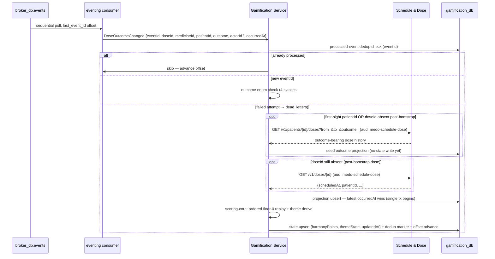

# HLD-MEDO-GAMIFICATION-001: Gamification Service — Harmony Points, Theme state, and outcome projection per Patient

## 1. Document control header

Gamification | backend-microservice | PRD-MEDO-GAMIFICATION-001@1.0 | approved

## 2. Design context and scope

### 2.1 Upstream PRD consumed

`PRD-MEDO-GAMIFICATION-001@1.0` (status: approved). Sections consumed by reference: §2 goals G-1…G-6 and non-goals NG-1…NG-10; §3 actors; §4 user stories US-GAM-01…06; §5 functional requirements FR-GAM-001…017 grouped 5.1 state & read API, 5.2 outcome projection & scoring, 5.3 bootstrap/consumption/purge, 5.4 boundary & versioning; §6 NFRs NFR-GAM-01…06; §8 edge cases; §8.1 dependency failure behavior; §9 data requirements; §10 contract inventory; §7.5 boundary statement; §7.4 open questions OQ-GAM-01…05. No requirement text is restated here (cite-don't-copy, hld-standard §6.1).

### 2.2 Component place in system

The Gamification Service is Medo's Monster Defense scoring engine (`service-catalog.md#gamification-service@2026-11-22`; PRD §7.5). It owns exactly one server-authoritative state per Patient — `{harmonyPoints, themeState, updatedAt}` — plus the per-`doseId` **outcome projection** that is its only scoring input, maintained exclusively from `DoseOutcomeChanged` events and pull-bootstrap reads against Schedule & Dose. It exposes a single public read route `GET /v1/patients/{id}/gamification`, publishes **no** events, exposes **no** internal routes, and runs **zero** scheduled jobs.

It does NOT own: dose truth, schedules, outcome classification, missed-lock, snooze, or `skippedByUser` plan-skip (Schedule & Dose — the projection is a scoring copy, never dose truth, NG-1); medicines, photos, Doses Remaining, or refill detection (Medicine — NG-2); reminders, feed, prefs, push, or email (Notification — NG-3); Care Link lifecycle, invites, or check-link ownership (Care — this service only calls `check-link` per read, NG-4); user accounts, profiles, credentials, or the directory of record (Identity — `patientId` = Identity `userId`, NG-5); levels, progression, battles, rewards, streaks, or per-caregiver scores (rejected Map 1 ticket 10, NG-6/7); offline score computation or Dexie caching (frontend shows last-known or hides the widget, NG-8); any published event such as `PointsChanged`/`ThemeChanged` (NG-9).

### 2.3 Design goals

- DG-GAM-1: Scoring is a pure deterministic function of the projection — identical projection contents always produce identical `{harmonyPoints, themeState}`; the ordered floor-0 recompute is the ONLY scoring mechanism (delta arithmetic forbidden, Map 2 ticket 06). [`PRD-MEDO-GAMIFICATION-001@1.0#FR-GAM-006`; `inherited:Map 2 ticket 06 via .scratch/medo-services/`]
- DG-GAM-2: The projection is event-sourced scoring input, not dose truth — every `DoseOutcomeChanged` updates at most one `doseId` row (latest `occurredAt` wins) and triggers a full ordered replay; score correctness self-heals because recompute is a pure function and bootstrap can re-seed. [`PRD-MEDO-GAMIFICATION-001@1.0#FR-GAM-005/008/009`]
- DG-GAM-3: Live-update completeness — EVERY accepted outcome event produces a persisted recompute before the consumer offset advances; there is no locked-only batching and no missed-update window. [`PRD-MEDO-GAMIFICATION-001@1.0#FR-GAM-008`; Map 2 ticket 06]
- DG-GAM-4: Authz is per-read and fail-closed — patient-self match OR Care `check-link` with positive-only ≤15 s cache; a Care/Schedule & Dose dependency failure denies or retries, never grants on stale data. [`PRD-MEDO-GAMIFICATION-001@1.0#FR-GAM-001/002/003/017`; `inherited:ticket-09@2026-11-21`]
- DG-GAM-5: Bootstrap-before-apply — first-sight or gap events never score against partial history; the doses-window pull completes and seeds the projection before the triggering event is applied, and an unseen `doseId` resolves via dose detail before recompute. [`PRD-MEDO-GAMIFICATION-001@1.0#FR-GAM-009/010`]
- DG-GAM-6: Purge completeness — `AccountDeleted` for a Patient `userId` removes ALL gamification state in one transaction; caregiver `userId` is a no-op; post-purge events cannot resurrect state. [`PRD-MEDO-GAMIFICATION-001@1.0#FR-GAM-013`]
- DG-GAM-7: Minimal surface — one public read route, zero internal routes, zero published events, zero scheduled jobs; the service is a pure consumer of two event types plus three internal reads. [`service-catalog.md#gamification-service@2026-11-22`; `scheduled-jobs.md@2026-11-21`]

### 2.4 Design non-goals

- Doses-window/dose-detail DTO field names (`scheduledAt` shape, pagination) → consumed contract detail owned by Schedule & Dose; LLD binds exact fields — non-blocking (`OQ-GAM-01`/`OQ-GAM-02` carry-forward).
- Bootstrap `from`/`to` window bounds and pagination strategy → LLD (`OQ-GAM-02`).
- Recompute performance guard / incremental caching → LLD profiling decision at envelope (`OQ-GAM-04`); full replay chosen at HLD level.
- Exact Drizzle schema, table/column layout, index design, Zod event schemas, DTO field encoding → LLD.
- Dexie schema, widget rendering, refetch cadence tuning → frontend HLD / LLD.
- Levels, streaks, battles, rewards, milestone feed rows, `PointsChanged`-style events → rejected/deferred upstream (PRD NG-6/9; `OQ-GAM-05` future map).
- Rate-limit numeric tuning beyond locked defaults → LLD config.

### 2.5 Inherited locked decisions

- Runtime/framework: Node.js + TypeScript + Fastify + Drizzle ORM (`inherited:.scratch/medo-backend/issues/01-backend-runtime-framework.md@2026-11-20` — `jose`, `fastify-type-provider-zod` among locked libs).
- Deployment/hosting: single AWS EC2 `t3.micro` + Docker Compose; frontend Vercel; `.env` local / SSM Parameter Store prod; Budget alert $25 (`inherited:…/02-deployment-model-hosting.md@2026-11-20`).
- Database: self-hosted Postgres container, six logical DBs with per-service users, `drizzle-kit` migrations; `gamification_db` + own DB user (`inherited:…/03-database-technology.md@2026-11-21`).
- Object storage: Cloudflare R2 — **not used by this service** (no file/photo storage; stated for completeness — `inherited:…/04-object-storage-provider.md@2026-11-21`).
- API gateway: Caddy reverse proxy, explicit public-route table, per-service JWT verify, proxy-level CORS (`inherited:…/05-api-gateway-entry-point.md@2026-11-21`).
- Auth token mechanics: user JWTs verified locally via Identity JWKS/static config; internal service JWTs `iss=medo-<caller>`, `aud=medo-<target>`, 5-min, minted per call, static pubkey config (`inherited:…/06-auth-token-mechanics.md@2026-11-21`).
- Event transport: per-service transactional outbox → publisher → `broker_db.events`; sequential in-order per consumer, `last_event_id` offset, `eventId` dedupe, 5 attempts → `broker_db.dead_letters`; `@medo/eventing` shared package (`inherited:…/07-message-broker-event-transport.md@2026-11-21`). Gamification publishes **no outbox rows** — consumption only; sequential order is relied upon for per-patient recompute ordering (per-patient ordering free, Map 3 ticket 07).
- Observability: Pino JSON + `X-Request-Id`/`eventId`; per-service `/metrics`, `/health`, `/ready`; Sentry per service (`inherited:…/08-observability.md@2026-11-21`; `platform-observability.md@2026-11-21`).
- Rate limiting & caching: per-service Fastify plugin, in-memory sliding window; public 30/min/IP, auth'd writes 60/min/userId, auth'd reads 300/min/userId, internal exempt; 429 + `Retry-After`; caller-side caches this service depends on: Care check-link positive-only ≤15 s TTL (`inherited:…/09-rate-limiting-caching.md@2026-11-21`; `…/10-notification-preferences-scope.md@2026-11-21` covers prefs ownership elsewhere — not applicable here).
- Domain: `simmaps.com` — `app.simmaps.com` (Vercel), `api.simmaps.com` (Caddy→EC2), `photos.simmaps.com` (R2) (`inherited:.scratch/medo-hld/issues/01-domain-selection.md@2026-11-22`).
- Deploy mechanism: `medo-infra` repo (`compose.yml` + `Caddyfile` + `deploy.sh`); git-SHA images on GHCR; `deploy.sh` health-gates `/health`+`/ready` ~60 s with auto-rollback to `.last-good` (`inherited:.scratch/medo-hld/issues/02-cicd-deploy-mechanism.md@2026-11-23`).
- Quality/ops baselines: `platform-quality-baseline.md@2026-11-21`, `scheduled-jobs.md@2026-11-21`, `platform-observability.md@2026-11-21`.
- Service boundary + contract surface: `service-catalog.md#gamification-service@2026-11-22` (Map 2 ticket 07; publishes none; consumes `DoseOutcomeChanged` + `AccountDeleted`).
- Feature rules: Harmony Points deltas +10/−5/−10/−20, floor 0, lifetime, no cap, no levels; theme machine Harmony/Uneasy/Horror; outcomes editable until midnight; server-authoritative shared patient+caregiver view; caregiver actions affect patient score only, no caregiver score (Map 1 ticket 10).
- Boundary mechanics: per-Patient state only, live updates every `DoseOutcomeChanged`, ordered floor-0 recompute (delta arithmetic rejected), pull-bootstrap on first sight/gap, check-link per read, read API only, `AccountDeleted` purge (Map 2 ticket 06).

## 3. System context

FIG-GAM-01: system context diagram

```mermaid
flowchart LR
    subgraph Users
        P[Patient]
        C[Caregiver]
    end
    FE[Combined Frontend<br/>app.simmaps.com]
    GAM[Gamification Service]
    SCH[Schedule & Dose Service]
    CARE[Care Service]
    ID[Identity Service]
    CADDY[Caddy reverse proxy<br/>api.simmaps.com]
    BROKER[(broker_db.events<br/>+ dead_letters)]
    PG[(Postgres container<br/>gamification_db + broker_db)]

    P --> FE
    C --> FE
    FE -->|public read route| CADDY
    CADDY --> GAM
    GAM -->|GET /v1/patients/{id}/doses + /v1/doses/{id}<br/>service JWT aud=medo-schedule-dose| SCH
    GAM -->|GET /v1/care/check-link<br/>service JWT aud=medo-care| CARE
    SCH -->|DoseOutcomeChanged| BROKER
    ID -->|AccountDeleted| BROKER
    BROKER -->|poll| GAM
    GAM --> PG
```

| Counterparty | Relationship (calls/consumes/publishes/is-called-by) | Contract(s) |
|---|---|---|
| Patient / Caregiver (via Combined Frontend) | is-called-by | `GET /v1/patients/{id}/gamification` (§7.1) |
| Combined Frontend | calls through Caddy; never calls internal routes (none exist) | §7.1; `frontend-map.md` Today + caregiver-view rows |
| Caddy reverse proxy | pass-through entry; public-route table | `inherited:ticket-05@2026-11-21` |
| Schedule & Dose Service | Gamification calls `GET /v1/patients/{id}/doses?from=&to=&outcome=` (bootstrap) + `GET /v1/doses/{id}` (unseen-dose fallback); Schedule & Dose publishes `DoseOutcomeChanged` consumed here | §7.2; §8.2 |
| Care Service | Gamification calls `GET /v1/care/check-link?patientId=&caregiverId=` per caregiver read; Care publishes no events consumed here (`CareLinkEnded` deliberately unsubscribed — check-link TTL bounds staleness) | §7.2 consumed row |
| Identity Service | publishes `AccountDeleted` consumed here; no REST calls (no directory lookups needed) | §8.2 |
| Medicine Service | no interaction — `MedicineArchived` deliberately unsubscribed (archived-medicine history stays in score) | none (explicit none) |
| Notification Service | no interaction — publishes nothing, has no feed | none (explicit none) |
| `broker_db` event fabric | consumes 2 event types via `@medo/eventing` poll; **publishes nothing** | §8.2; `inherited:ticket-07@2026-11-21` |
| UptimeRobot | `GET /health` liveness target | `platform-observability.md@2026-11-21` |

## 4. Application topology and service boundaries

### 4.1 Deployable unit & entry path

Gamification runs as the `gamification` container in the single Docker Compose stack on the AWS EC2 `t3.micro` (region ap-south-1 recommended, confirmed at deploy), alongside the other five services and the shared Postgres container (`inherited:ticket-02@2026-11-20`, `ticket-03@2026-11-21`, `.scratch/medo-hld/issues/02-cicd-deploy-mechanism.md@2026-11-23`). Public traffic enters via `api.simmaps.com` → Caddy → explicit public-route table → `gamification` for its single public route (`inherited:ticket-05@2026-11-21`, `.scratch/medo-hld/issues/01-domain-selection.md@2026-11-22`). Service-to-service calls go direct on the Docker network with per-service JWTs. Deploys are manual SSH via `medo-infra` (`deploy.sh` health-gates + rollback) pulling git-SHA images from GHCR. The `@medo/eventing` consumer worker runs inside this same process — no worker service; the service embeds **zero** `node-cron` jobs (`scheduled-jobs.md@2026-11-21` — explicit zero-jobs row).

### 4.2 Boundary statement

Mirroring `service-catalog.md#gamification-service@2026-11-22` and PRD §7.5: Gamification solely owns Harmony Points and Theme state per Patient — the `{harmonyPoints, themeState, updatedAt}` state row, the per-`doseId` outcome projection used for scoring, the ordered floor-0 recompute, pull-bootstrap via Schedule & Dose, the single read route with per-read authz, and `AccountDeleted` purge.

Denied capabilities (explicit): no dose/schedule/outcome truth, classification, missed-lock, snooze, or plan-skip semantics (Schedule & Dose — the projection stores scoring fields only and is never authoritative); no medicines, photos, or Doses Remaining (Medicine); no reminders, feed, prefs, push, or email (Notification); no Care Link lifecycle or check-link ownership (Care — `check-link` is a consumed call with ≤15 s positive cache); no accounts, sessions, profiles, or directory ownership (Identity — `AccountDeleted` is the only Identity touchpoint); no client-writable score surface (no public writes exist at all); no event publication (catalog: publishes none); no scheduled jobs (`scheduled-jobs.md` zero-jobs row).

### 4.3 Boundary invariants

- Own repository, own logical database `gamification_db` in the shared Postgres container with own DB user; cross-DB access prohibited — peers are reached only via contracts/events (`inherited:ticket-03@2026-11-21`). `broker_db` is read/written only through `@medo/eventing` consumer machinery.
- No shared domain models or schemas with peer services; DTOs at every boundary (`service-catalog.md#conventions@2026-11-22`). `doseId`/`medicineId`/`patientId`/`userId`/`actorId` are opaque foreign references — never resolved into peer schemas beyond the cataloged doses/check-link reads.
- Four logical layers `Infrastructure / Core / Application / WebAPI` per Architecture Standard; every §5 block carries exactly one primary layer (cross-layer justified inline).
- Read/write flow pattern: HTTP requests enter `webapi-public` (Zod DTO validation, rate-limit plugin, session authz binding) → Core rules via `persistence` repositories → `gamification_db`. Off-request: `eventing` consumer workers orchestrate Application-level reactions — peer I/O via `schedule-dose-client`/`care-client`, never inside the `gamification_db` transaction except the local projection+state+offset commit (HD-GAM-04/05). Deviations: none — bootstrap's upstream pulls complete BEFORE the local projection write begins, keeping peer I/O outside transactions.

FIG-GAM-02: topology position

```mermaid
flowchart TB
    subgraph EC2["AWS EC2 t3.micro — Docker Compose"]
        CADDY[Caddy :443<br/>public-route table]
        subgraph SVC["backend services (Docker network)"]
            GAM[Gamification]
            SCH[Schedule & Dose]
            CARE[Care]
            ID[Identity]
            MED[Medicine]
            NOT[Notification]
        END
        PG[(Postgres container<br/>6 logical DBs incl. gamification_db + broker_db)]
        GAM --- PG
        SCH --- PG
        CARE --- PG
        ID --- PG
        MED --- PG
        NOT --- PG
    END
    FE["Combined Frontend — Vercel<br/>app.simmaps.com"] -->|HTTPS| CADDY
    CADDY -->|1 public route only| GAM
    GAM <-.->|GET /v1/patients/{id}/doses · /v1/doses/{id}| SCH
    GAM <-.->|GET /v1/care/check-link| CARE
    SCH -.->|DoseOutcomeChanged| BROKERX[broker_db.events]
    ID -.->|AccountDeleted| BROKERX
    SVC <-.->|broker_db.events poll| PG
```

## 5. Decomposition and internal structure

| Block | Responsibility | Layer | Contracts/events | HD-ref |
|---|---|---|---|---|
| `webapi-public` | HTTP presentation for the single public route `GET /v1/patients/{id}/gamification`; user-JWT verification boundary; read authz orchestration entry (patient-self match → `check-link` fallback) — the only WebAPI surface, **no internal routes exist** | WebAPI | §7.1 public row | HD-GAM-01/05 |
| `rate-limit` | Per-route sliding-window limiter plugin (auth'd read class — the route is session-scoped patient route; no public-by-IP rows exist) + 429/`Retry-After` | WebAPI | §7.1 row | — |
| `gamification-state-core` | Patient state rules: `{harmonyPoints, themeState, updatedAt}` row per `patientId`, lazy-create defaults `{0, Harmony}` on first persisted recompute, single-row upsert per recompute, read DTO projection `{harmonyPoints, themeState, updatedAt}` only | Core | read route; invoked by `scoring-core` writes | HD-GAM-02 |
| `outcome-projection-core` | Per-`doseId` projection rules: `{patientId, scheduledAt, outcome, actorId?, occurredAt}` upsert with latest-`occurredAt`-wins, `actorId` stored for audit but never scored, `patientId` consistency enforcement, outcome-enum filtering (4 classes only; snooze/plan-skip carry no contribution) | Core | consumes `DoseOutcomeChanged` payload fields; bootstrap seed input | HD-GAM-02/03 |
| `scoring-core` | Ordered floor-0 recompute: sort projection by `scheduledAt` asc (tie-break `doseId`), replay +10/−5/−10/−20 with running `max(0, total+delta)` clamp; theme derivation as pure function of latest scheduled outcome (Harmony/Uneasy/Horror); emits the persisted `{points, theme, updatedAt}` triple | Core | invoked by `event-consumer` + `bootstrap-orchestrator` after projection writes | HD-GAM-03 |
| `bootstrap-orchestrator` | First-sight/gap detection + pull-bootstrap: when a `patientId` has no projection or an event's `doseId` is absent post-bootstrap, pull `GET /v1/patients/{id}/doses?from=&to=&outcome=` full outcome history → seed projection → apply triggering event; `GET /v1/doses/{id}` fallback for unseen doseIds (scheduledAt + patientId consistency); bootstrap-before-apply ordering, at most once per gap episode | Application | §7.2 consumed rows; invoked by `event-consumer` | HD-GAM-04 |
| `event-consumer` | `@medo/eventing` consumer worker: 2 subscribed event types → per-type reactions (`DoseOutcomeChanged` → projection update → recompute → persist; `AccountDeleted` → purge); sequential in-order, `last_event_id` offsets, per-`eventId` dedupe | Application | consumes 2 events; invokes `outcome-projection-core`, `scoring-core`, `gamification-state-core`, `bootstrap-orchestrator`, `account-deletion-consumer` | HD-GAM-05 |
| `account-deletion-consumer` | `AccountDeleted` reaction: single-tx purge of patient state row + entire outcome projection + purge tombstone write; caregiver `userId` = no-op; post-purge events ignored (no resurrection) | Application | consumes `AccountDeleted` | HD-GAM-06 |
| `schedule-dose-client` | Schedule & Dose internal calls: `GET /v1/patients/{id}/doses?from=&to=&outcome=` (bootstrap window pull) + `GET /v1/doses/{id}` (unseen-dose fallback); service JWT `aud=medo-schedule-dose`, 5-min minted per call; timeout/retry per §14 | Infrastructure | §7.2 consumed rows | HD-GAM-04 |
| `care-client` | Care `GET /v1/care/check-link?patientId=&caregiverId=` internal call (`aud=medo-care`); positive-only ≤15 s caller-side cache, negatives/invalid never cached; per-read authz for caregiver sessions | Infrastructure | §7.2 consumed row | HD-GAM-05 |
| `persistence` | `gamification_db` repositories (state rows, projection rows, purge tombstones, consumer offsets via `@medo/eventing`); **no outbox table** — the service publishes nothing | Infrastructure | §6.1/§8 | — |
| `eventing` | `@medo/eventing` consumer worker(s): sequential poll of `broker_db.events`, per-consumer `last_event_id` offset, `eventId` dedupe, 5 attempts → `dead_letters` | Infrastructure | §8.2 consumed events | HD-GAM-05 |

Read/write flow: HTTP requests enter `webapi-public` (Zod DTO validation, rate-limit plugin, session authz — patient-self `sub` match first, `care-client` check-link for caregiver sessions) → `gamification-state-core` read via `persistence` → `gamification_db`. Off-request: `eventing` consumer workers route through `event-consumer` — `DoseOutcomeChanged` reactions run `bootstrap-orchestrator` (when first-sight/gap) → `outcome-projection-core` upsert → `scoring-core` replay → `gamification-state-core` persist in one `gamification_db` transaction; `AccountDeleted` routes to `account-deletion-consumer` single-tx purge. Peer I/O (`schedule-dose-client`, `care-client`) is always outside `gamification_db` transactions — bootstrap completes fully before any local write begins (HD-GAM-04). Cross-layer deviations: none.

## 6. Data architecture

### 6.1 Owned store & entity inventory

Owned store: `gamification_db` — sole ownership; never shared, never read by peers (`PRD-MEDO-GAMIFICATION-001@1.0#9.1`; `inherited:ticket-03@2026-11-21`). Persistence approach: PostgreSQL + Drizzle ORM + `drizzle-kit` migrations at deploy (`inherited:ticket-01/03`). Shape classification at approach level: relational entity set (patient state, outcome projection, purge tombstones, consumer offsets) — uniform platform pattern, no `HD-` needed for the store choice itself.

Entity inventory (ownership granularity, lifecycle per PRD §9.1 — cited, not re-derived):

| Entity | Lifecycle class | Notes |
|---|---|---|
| Patient gamification state (patientId, harmonyPoints, themeState, updatedAt) | lazy-create on first persisted recompute → upsert per accepted event → purge on `AccountDeleted` | single row per patient; absent row = implicit defaults `{0, Harmony}` (FR-GAM-001c); read DTO exposes exactly `{harmonyPoints, themeState, updatedAt}` — no per-dose breakdown, no actorIds, no eventIds |
| Dose outcome projection (doseId PK, patientId, scheduledAt, outcome, actorId?, occurredAt) | insert on first sight of doseId (event or bootstrap) → update on later events (latest `occurredAt` wins) → purge on `AccountDeleted` | scoring input ONLY — not dose truth (NG-1); retains full history for lifetime ordered replay; `actorId` stored for audit, never scored, never exposed in read DTO |
| Purge tombstones (patientId, purgedAt) | insert on `AccountDeleted` reaction → retained for account lifetime | prevents post-purge `DoseOutcomeChanged` resurrection (FR-GAM-013c; HD-GAM-06) |
| Consumer offsets (`last_event_id` per subscribed type) | advance per consumed event | `@medo/eventing` pattern — sequential in-order delivery; NOT per-patient, never purged by `AccountDeleted` |
| Processed-event dedup markers | insert per handled `eventId` → bounded retention | backs per-`eventId` idempotency (FR-GAM-011) |

### 6.2 Shared / consumed data

- **No shared/community data** — all owned data is per-patient private (PRD §9.3). No catalog or cross-user entities exist.
- Consumed (sync, internal REST): Schedule & Dose `GET /v1/patients/{id}/doses?from=&to=&outcome=` — the bootstrap source for full outcome-bearing dose history (FR-GAM-009); window bounds/pagination = LLD (`OQ-GAM-02`). Schedule & Dose `GET /v1/doses/{id}` — per-dose fallback resolving `scheduledAt` + `patientId` consistency for doseIds outside bootstrap coverage (FR-GAM-010). Care `GET /v1/care/check-link?patientId=&caregiverId=` — per-read caregiver authz (FR-GAM-002); positive-only ≤15 s cache, negatives/invalid never cached (`inherited:ticket-09@2026-11-21`).
- Read-through data owned elsewhere: `doseId`/`medicineId`/`patientId`/`userId`/`actorId` are opaque references resolved only through contracts — no peer schemas replicated; the projection stores the minimal scoring fields the cataloged DTOs expose.

### 6.3 Consistency & coordination model

- Local transaction ownership: each accepted `DoseOutcomeChanged` commits projection upsert + recompute + state upsert (+ dedup marker) in ONE `gamification_db` transaction — the offset advances only after this commit succeeds (`@medo/eventing` semantics). `AccountDeleted` purge is one consumer transaction covering state + projection + tombstone (HD-GAM-06).
- Cross-service workflows (§8.4): event consumption is event-then-react (consume → dedup-check → maybe-bootstrap → project → recompute → persist → advance offset); reads are request-then-answer (authz → state read). No compensating actions exist — coordination is event-then-local-recompute or sync-call-then-read.
- Event consistency: consumes via `@medo/eventing` — sequential in-order per consumer, `last_event_id` offset advanced only after successful reaction, at-least-once + `eventId` dedupe, 5 attempts → `broker_db.dead_letters` (`inherited:ticket-07@2026-11-21`). Gamification publishes **nothing** — no outbox table exists in `gamification_db`.
- Bootstrap consistency: the upstream doses pull happens entirely BEFORE the first local write for that gap episode — a bootstrap failure means zero projection rows and the event retries (FR-GAM-009b); there is no partial-seed state. Ordering guarantee: sequential consumer means no second event interleaves between bootstrap and apply.
- Projection consistency: per-`doseId` latest-`occurredAt`-wins makes redelivery and out-of-order `occurredAt` safe (FR-GAM-005); `patientId` mismatch on dose detail rejects the event (FR-GAM-010b) — cross-patient contamination is structurally impossible.
- Recompute consistency: full ordered replay per event is O(patient dose count) — deterministic by construction (sort key `scheduledAt` + `doseId` tie-break); identical projection ⇒ identical result every run (DG-GAM-1).
- Read consistency: reads return last persisted state — a recompute in flight is invisible until commit; stale-read bound = one event latency (PRD §8 accepted).

### 6.4 Retention & deletion

Per `platform-quality-baseline.md#data-retention@2026-11-21` + `scheduled-jobs.md@2026-11-21`, Gamification-owned obligations:

- Patient gamification state + outcome projection + purge tombstones: **account lifetime** — required for lifetime cumulative score and ordered replay; purged ONLY on `AccountDeleted` (FR-GAM-013). No time-based retention applies (baseline retention table has no gamification row → lifetime by necessity, PRD §9.4).
- Processed-event dedup markers: bounded retention aligned to event-replay horizon (LLD tunes exact TTL — non-blocking, mirrors sibling `OQ-HLD-NTF-01` pattern).
- Consumer offsets: advance continuously; reset-safe per `@medo/eventing`.
- Dead letters: platform-wide retention (>30d purge by Notification service's `broker-watchdog` — sole writer per `scheduled-jobs.md`; this service does NOT subscribe to or own that job).
- No scheduled retention jobs exist in this service — zero jobs row (`scheduled-jobs.md`).
- No backups in v1 — accepted risk (`platform-quality-baseline.md`).

## 7. External contracts

### 7.1 Exposed contracts

| Contract (verbatim) | Block | Sync/Async | Public/Internal | Authz binding | Idempotent? | Rate-limit class | Catalog ref |
|---|---|---|---|---|---|---|---|
| `GET /v1/patients/{id}/gamification` | `gamification-state-core` via `webapi-public` | REST sync | public | patient-self (`patientId` = session `sub`) OR linked caregiver via Care `check-link` per read | n-a (read-only; no writes exist) | auth'd read 300/min/userId | catalog §Gamification public REST |

This is the service's **entire** HTTP surface — one row. No write methods exist (any non-GET → 405/404, FR-GAM-015); no internal REST routes exist (catalog: "Internal REST — None — read API only; no service callers"). The route is patient-scoped per catalog convention (`/patients/{patientId}/`); `patientId` = Identity `userId` for Patient accounts (`frontend-map.md` patientId rule).

### 7.2 Consumed contracts

| Contract (verbatim) | Provider | Sync/Async | Public/Internal | Cache/staleness binding | Failure ref (§14) | Catalog ref |
|---|---|---|---|---|---|---|
| `GET /v1/patients/{id}/doses?from=&to=&outcome=` | Schedule & Dose Service | sync REST | internal | none — bootstrap pull is one-shot per gap episode; response seeds projection, never cached | §14 row SCH-DOSES | catalog §Schedule & Dose internal REST |
| `GET /v1/doses/{id}` | Schedule & Dose Service | sync REST | internal | none — per-event fallback for unseen doseIds | §14 row SCH-DOSE-DETAIL | catalog §Schedule & Dose internal REST |
| `GET /v1/care/check-link?patientId=&caregiverId=` | Care Service | sync REST | internal | positive-only ≤15 s caller-side TTL; negatives/invalid NEVER cached; link revocation effective within TTL bound | §14 row CARE-CHECKLINK | catalog §Care internal REST |

### 7.3 Contract realization notes (backend profile §4.3/§4.5)

- Route groups: `webapi-public` hosts the single public route — the service's entire HTTP surface; there is **no** `webapi-internal` block and no internal REST routes (catalog: "Internal REST — None"). Callee-side expectation for inbound calls is moot — nothing calls in; all peer calls are outbound with minted service JWTs.
- Shared aggregates: the patient state row underlies the single read route and every recompute write — one Core aggregate (`gamification-state-core`) serves both directions.
- Thin proxies: none — the read route executes authz + state read against `gamification_db`; absent state row returns implicit defaults `{0, Harmony}` per FR-GAM-001c.
- Sync fan-out to peers: `schedule-dose-client` issues the bootstrap window pull (once per gap episode) + dose-detail fallback (per unseen doseId); `care-client` issues `check-link` per caregiver read (≤15 s positive cache absorbs repeat reads). All peer I/O is pre-transaction orchestration — bootstrap completes before any `gamification_db` write; check-link resolves before the state read. Timeout/retry/fail-mode per §14.
- Internal surface: **zero exposed rows** — explicit per catalog. Outbound calls mint `aud=medo-schedule-dose` / `aud=medo-care` per call, 5-min tokens (`inherited:ticket-06@2026-11-21`).
- Caller-side caching obligations: only the Care check-link positive cache (≤15 s TTL, negatives never cached) exists — mandated by `inherited:ticket-09@2026-11-21`; the doses pulls are deliberately uncached (one-shot correctness inputs, not repeatable lookups).
- DTO rules: the read DTO is exactly `{harmonyPoints, themeState, updatedAt}` — no internal fields (no per-dose breakdown, no actorIds, no eventIds, no patientId echo beyond the path param) by design (PRD §10.1); consumers cannot reconstruct dose history from this route.

## 8. Integration events and workflows

### 8.1 Published events

**None — explicit per catalog** ("Publishes: none — no `PointsChanged`/`ThemeChanged` — no consumer exists"). `gamification_db` contains no outbox table; `eventing` runs consumer workers only. No Gamification action produces a `broker_db.events` row — score propagation to clients happens exclusively via the read API + frontend refetch (`refetchInterval` ≈ 15 min + post-mutation refresh per `frontend-map.md`).

### 8.2 Consumed events

Both subscriptions flow through `eventing` → `broker_db.events` sequential in-order poll with own-DB `last_event_id` offsets; every applied event dedupes per `eventId` via processed-event markers (FR-GAM-011). Failures retry per `@medo/eventing` — 5 attempts → `broker_db.dead_letters`, manual replay only.

| Event (verbatim) | Producer | Required reaction | Idempotent-consumer statement | Failure path |
|---|---|---|---|---|
| `DoseOutcomeChanged` | Schedule & Dose | Projection upsert for `doseId` (latest `occurredAt` wins; outcome ∈ 4 classes only) → maybe bootstrap-orchestrator (first-sight/gap) → `scoring-core` ordered floor-0 recompute + theme derive → persist `{harmonyPoints, themeState, updatedAt}` in one tx | Per-`eventId` dedup → one recompute; per-`doseId` latest-`occurredAt` → redelivery/out-of-order safe; bootstrap idempotent under redelivery | 5 attempts → `dead_letters`; bootstrap/dose-detail upstream failure = event not applied, retries; manual replay recovers |
| `AccountDeleted` | Identity | `account-deletion-consumer` single-tx purge: patient state row + entire outcome projection + purge-tombstone write for `patientId` (= `userId` for Patient accounts); caregiver `userId` = no-op | Terminal-state idempotent — redelivery finds tombstone/nothing to purge; tombstone blocks post-purge resurrection | 5 attempts → `dead_letters`; manual replay |

### 8.3 Explicit none-statements

- Publishes **zero** events — `gamification_db` has no outbox table; no Notification/feed integration exists by design (`OQ-GAM-05` deferred to a future map).
- `MedicineArchived` is deliberately NOT subscribed: archived medicines' historical outcomes remain in the projection — lifetime score is history, not current-schedule (PRD §8 edge table; catalog subscription list = exactly 2 events).
- `CareLinkEnded` and the other 4 Care events are NOT subscribed: this service stores zero link state — `check-link` per read with ≤15 s positive TTL is the entire revocation bound (Map 2 ticket 02 rule preserved; sibling-consistent with Schedule & Dose HLD).
- `UserRegistered`/`ProfileChanged`/auth-email events/`RefillThresholdCrossed` are NOT subscribed — no scoring or authz relevance.
- No reminder/due/feed/push events exist in either direction — the service is event-consumer + read-API only.
- Snooze and `skippedByUser` plan-skip produce **no** `DoseOutcomeChanged` (they are not outcome classes — Schedule & Dose contract `outcome` enum has exactly 4 values; `OQ-GAM-03` resolved-by Schedule & Dose FR-SD-006a semantics + enum); FR-GAM-004 ignores any non-enum payload value defensively regardless.

### 8.4 Cross-service workflows

| Workflow | FIG | Coordination model per hop | Failure semantics |
|---|---|---|---|
| `DoseOutcomeChanged` consume → projection → recompute → persist | FIG-GAM-04-1 | `broker_db.events` → `eventing` sequential poll → `event-consumer` dedup-check → (first-sight/gap: `bootstrap-orchestrator` → `schedule-dose-client` doses pull → seed projection) → `outcome-projection-core` upsert → `scoring-core` replay → `gamification-state-core` persist (one tx) → advance offset | upstream bootstrap/dose-detail failure ⇒ event not applied, consumer retries → `dead_letters` after 5; poison payload ⇒ zod validation failed attempt → `dead_letters`; redelivery deduped per `eventId` + latest-`occurredAt` |
| Pull-bootstrap (first sight / gap) | FIG-GAM-04-2 | unseen `patientId`/`doseId` detected inside `event-consumer` → `bootstrap-orchestrator` → `schedule-dose-client` `GET /v1/patients/{id}/doses?from=&to=&outcome=` full history → seed projection rows → apply triggering event; post-window unseen `doseId` → `GET /v1/doses/{id}` for `scheduledAt`+`patientId` check | bootstrap failure ⇒ zero local writes, event retries (no partial projection — FR-GAM-009b); dose-detail failure ⇒ event retries (FR-GAM-010); `patientId` mismatch ⇒ event rejected |
| Gamification read (patient-self / caregiver) | FIG-GAM-04-3 | frontend → Caddy → `webapi-public` → session `sub` vs path `patientId` match → allow; else `care-client` `check-link` (≤15 s positive cache) → `gamification-state-core` read → DTO `{harmonyPoints, themeState, updatedAt}` | check-link down ⇒ fail closed (deny/503 per baseline); ≤15 s positive cache absorbs blips; negatives never cached; own-DB down ⇒ 503 |
| `AccountDeleted` consume → purge | FIG-GAM-04-4 | Identity `AccountDeleted` → `eventing` poll → `account-deletion-consumer` single tx: delete state row + projection rows + insert purge tombstone | idempotent re-run; tombstone makes post-purge `DoseOutcomeChanged` a no-op (no resurrection); caregiver `userId` ⇒ no-op consumed cleanly |

FIG-GAM-04-1: `DoseOutcomeChanged` consume → projection → recompute → persist



FIG-GAM-04-2: pull-bootstrap (first sight / gap)

```mermaid
sequenceDiagram
    participant EV as event-consumer
    participant BO as bootstrap-orchestrator
    participant SCH as Schedule & Dose
    participant DB as gamification_db
    EV->>BO: trigger — patientId has no projection rows OR event doseId absent after prior bootstrap
    BO->>SCH: GET /v1/patients/{id}/doses?from=&to=&outcome= (service JWT aud=medo-schedule-dose)
    SCH-->>BO: full outcome-bearing dose history
    BO->>DB: seed projection rows {doseId, patientId, scheduledAt, outcome, actorId?, occurredAt}
    Note over BO,DB: doses with no outcome contribute nothing (FR-GAM-009c)
    BO-->>EV: projection seeded — apply triggering event normally
    opt event doseId outside bootstrap window
        EV->>SCH: GET /v1/doses/{id}
        SCH-->>EV: dose detail {scheduledAt, patientId}
        EV->>EV: patientId consistency check — mismatch ⇒ reject event
    end
    Note over BO,SCH: bootstrap failure ⇒ event NOT applied; consumer retries → dead_letters after 5
```

FIG-GAM-04-3: gamification read (patient-self / caregiver)

```mermaid
sequenceDiagram
    participant FE as Combined Frontend
    participant CADDY as Caddy
    participant GAM as Gamification Service
    participant CARE as Care Service
    participant DB as gamification_db
    FE->>CADDY: GET /v1/patients/{id}/gamification (Bearer access JWT)
    CADDY->>GAM: pass-through (public-route table)
    GAM->>GAM: verify user JWT (Identity JWKS/static config)
    alt patientId == session sub
        GAM->>DB: read state row (absent ⇒ defaults {0, Harmony})
        DB-->>GAM: {harmonyPoints, themeState, updatedAt}
        GAM-->>FE: 200 DTO
    else caregiver session
        GAM->>CARE: GET /v1/care/check-link?patientId=&caregiverId= (aud=medo-care; ≤15s positive cache)
        CARE-->>GAM: active link?
        alt active
            GAM->>DB: read state row
            DB-->>GAM: state
            GAM-->>FE: 200 DTO (same state patient sees)
        else no link / check-link down
            GAM-->>FE: deny (4xx) / 503 — no existence or score leakage
        end
    end
```

FIG-GAM-04-4: `AccountDeleted` consume → purge

```mermaid
sequenceDiagram
    participant ID as Identity Service
    participant BR as broker_db.events
    participant GAM as Gamification Service
    participant DB as gamification_db
    ID->>BR: AccountDeleted {userId} (same tx as account purge)
    BR->>GAM: sequential poll, last_event_id offset
    GAM->>GAM: userId == Patient account? (payload role semantics — Patient userId purges; Caregiver userId = no-op)
    GAM->>DB: single tx: delete state row + all projection rows for patientId + insert purge tombstone
    Note over GAM,DB: tombstone ⇒ later DoseOutcomeChanged for patientId is ignored (no resurrection);<br/>no Gamification event emitted on purge
```

## 9. Frontend contract surface

| frontend-map row | Screen/module | Contract IDs used | Sync pattern | Offline classification |
|---|---|---|---|---|
| Today (gamification leg) | Today screen | `GET /v1/patients/{id}/gamification` | parallel fan-out leg alongside Schedule & Dose doses window + Notification feed/unread + Medicine medicines calls | **API-only — never Dexie-cached** (frontend-map rule); widget shows last-known or hides offline |
| Caregiver gamification view | Caregiver view of linked patient | `GET /v1/patients/{id}/gamification` — same endpoint; authz = Care check-link per read server-side | user-driven read on view open + shared refetch triggers | API-only; read-only by construction (no write routes exist) |

`patientId` rule binding: Patient accounts pass `patientId` = session `sub` (Identity `userId` — no separate Patient entity); Caregiver accounts pass the selected Care Link's `patientId` via the patient switcher (`GET /v1/care/links` — Care-owned, not this service). Gamification is the ONLY Medo service where the path `patientId` may differ from session `sub` — that is precisely why `check-link` authz exists here. Offline implications: the route is API-only and never enters the Dexie store or the FIFO write-queue (frontend-map "API-only" rule — score is server-authoritative/cosmetic); internal contracts (`/v1/patients/{id}/doses`, `/v1/doses/{id}`, `/v1/care/check-link`) are never called by the frontend. Live-update reach: clients learn of score changes exclusively via TanStack Query refetch — `refetchInterval` ≈ 15 min on Today queries + post-mutation refresh + reconnect trigger (`frontend-map.md` refresh rules); there is no push/event channel for score changes (publishes none).

## 10. Cross-cutting concerns

### 10.1 Authentication & authorization summary

Two token domains (`inherited:ticket-06@2026-11-21`):

- **User JWTs** — issued by Identity, verified locally via JWKS/static config on the single public route. Authz per read: `patientId` = session `sub` → allow (patient-self); otherwise the session must be a Caregiver with an active Care Link → Care `check-link` required per read (FR-GAM-001/002/003/016). Caregiver reads are read-only by construction — no write routes exist at all. Denial responses reveal nothing about patient existence or score (FR-GAM-003c).
- **Service JWTs** — outbound only: `schedule-dose-client` mints `aud=medo-schedule-dose`, `care-client` mints `aud=medo-care`, both 5-min tokens per call. No inbound service-JWT routes exist — the service exposes nothing to peers.

Authz level per contract is stated in §7.1/§7.2; the distinctive Gamification rules: check-link positive answers cache ≤15 s (negatives never cached — revocation bound), and the frontend is never trusted — every read re-verifies server-side.

### 10.2 Observability binding

Per `platform-observability.md@2026-11-21` with Gamification deltas:

- Logs: Pino JSON, `service=gamification`, `requestId`/`eventId` correlation; projection/state rows carry `patientId`/`doseId` correlation IDs only — never emails, names, medicine names, or clinical detail (NFR-GAM-05/06).
- `GET /metrics` (service-JWT gated, internal): fixed RED set + Gamification counters — gamification reads ok/denied, check-link calls + cache hit/miss, events consumed per type + dedup hits, recompute count + duration, bootstrap count + failures, dose-detail fallbacks, projection rows seeded, `dead_letters` count, consumer lag (PRD NFR-GAM-06).
- Sentry project: `medo-gamification` (DSN via env/SSM).
- `GET /health` public liveness; `GET /ready` internal readiness — dependency checks: own `gamification_db` ping + `broker_db` ping (consumer). Deps named: `gamification_db`, `broker_db`. Upstream REST (Schedule & Dose doses reads, Care check-link) is NOT a readiness dep — it degrades per §10.3.

### 10.3 Resilience binding

Gamification's dependency rows from `platform-quality-baseline.md#resilience-defaults@2026-11-21`:

| Dependency | Binding |
|---|---|
| Own Postgres (`gamification_db`) | 5 s fast-fail → 503 on reads; consumer aborts batch, retries next poll (baseline matrix); cited |
| Care `GET /v1/care/check-link` (internal REST row) | 3 s timeout + 1 retry/200 ms → **read fails closed** (deny/503); ≤15 s positive cache absorbs blips; negatives never cached (FR-GAM-002); cited |
| Schedule & Dose `GET /v1/patients/{id}/doses` + `GET /v1/doses/{id}` (internal REST row) | 3 s timeout + 1 retry/200 ms → **event not applied**; consumer retries per `@medo/eventing` → `dead_letters` after 5; manual replay recovers (FR-GAM-009b/010); cited |
| `broker_db` event transport (2 consumers, no publisher) | consumer retry built into `@medo/eventing`; 5 attempts → `dead_letters`; cited |

Inbound callers: the combined frontend only (1 public route via Caddy). No service calls Gamification — it exposes no internal routes.

### 10.4 Rate limiting & caching

Per `inherited:ticket-09@2026-11-21`: per-service Fastify plugin, in-memory sliding window; internal service-JWT routes exempt (none exist here); 429 + `Retry-After`. Gamification deltas: the single route uses the auth'd read class — 300/min/userId; there are **no** public-by-IP routes (the route is session-scoped patient route — `vapid-key`-style public routes do not exist here). Caches: the **Care check-link positive-only ≤15 s TTL** in `care-client` — negatives/invalid never cached, event-invalidation NOT required (positive TTL self-expires; `CareLinkEnded` is deliberately unsubscribed — ≤15 s staleness bound documented). No other caches — reads are single-row lookups; bootstrap/dose-detail pulls are one-shot uncached correctness inputs. In-memory rate-limit windows + check-link cache valid because single-instance (`inherited:ticket-09`).

### 10.5 Error handling & input protection

Standard JSON error body platform-wide; `Retry-After` on 429; fail-cleanly rule (clear 4xx/5xx, never crash/hang; degrade where cheap; no silent data loss) per `platform-quality-baseline.md#availability`. DTO-at-boundary with Zod validation at `webapi-public` (`inherited:ticket-01@2026-11-20` libs). Response posture: malformed `patientId` (non-UUID/garbage) → 4xx before authz; unauthenticated → 401; authenticated-but-unauthorized → denied without existence/score leakage (FR-GAM-003c); nonexistent-but-authorized patientId (patient-self with valid session, zero history) → defaults `{0, Harmony}` (FR-GAM-001c); non-GET methods → 405/404 (FR-GAM-015); event payloads failing zod schema (unknown outcome enum, missing fields) → failed attempt → `dead_letters` after 5, never partial projection.

### 10.6 Sensitive-data handling

PII/secrets inventory (PRD §9.5, NFR-GAM-05): Harmony Points + Theme state = health-adjacent adherence data — treated as PII-adjacent; `actorId` in the projection = attribution record (which user marked the dose) — minimal PII retained for audit, never exposed in the read DTO; `patientId`/`doseId`/`eventId` correlation IDs in logs only. The service stores NO emails, names, medicine names, or clinical detail — the read DTO is `{harmonyPoints, themeState, updatedAt}` only. `gamification_db` holds per-patient private rows only — purged wholesale on `AccountDeleted`. Event payloads carry minimal fields per catalog conventions (data minimization — `actorId?` optional). No secrets beyond the standard set: service private key (mint `aud=medo-schedule-dose`/`aud=medo-care` calls), DB credentials, Sentry DSN — env/SSM (`inherited:ticket-02/06`). No backups in v1 — accepted risk.

## 11. Security architecture

### 11.1 Trust boundaries

| Boundary | Mechanism | Binding |
|---|---|---|
| Internet → Caddy → Gamification (public route) | explicit public-route table only; unlisted = 404; user JWT verified per-service | `inherited:ticket-05@2026-11-21` |
| Internal routes → Gamification | **none exist** — no internal REST surface; nothing to gate inbound | catalog §Gamification internal REST = None |
| Gamification → Schedule & Dose | per-service JWTs minted per call (`aud=medo-schedule-dose`, 5-min) | `inherited:ticket-06@2026-11-21` |
| Gamification → Care | per-service JWTs minted per call (`aud=medo-care`, 5-min) | `inherited:ticket-06@2026-11-21` |
| Frontend → API | `Authorization: Bearer` access JWT; refresh cookie `HttpOnly; Secure; SameSite=Lax; Path=/v1/auth`, host-only on `api.simmaps.com`, set by Identity via proxy | `inherited:ticket-05@2026-11-21`; domain ticket 01 |
| CORS | terminated once at Caddy; exact-origin allowlist + `Allow-Credentials`; no wildcard+credentials | `inherited:ticket-05@2026-11-21` |

### 11.2 Token lifecycle binding

Gamification is stateless-verify only for inbound and mint-per-call for outbound (`inherited:ticket-06@2026-11-21`):

- User access JWTs: 25-min stateless, verified via Identity JWKS/static config; revocation lag ≤25 min accepted platform-wide.
- Refresh/session lifecycle: entirely Identity-owned — Gamification has no obligation beyond rejecting expired/invalid access JWTs.
- Service JWTs: 5-min aud-scoped, minted per call for doses reads (`aud=medo-schedule-dose`) and check-link (`aud=medo-care`) — no caching of minted tokens.
- `actorId`/identity fields are never trusted from clients — the read DTO exposes no actor data and no client input can influence scoring (no write surface exists).

### 11.3 Data exposure analysis

- Read DTO: `{harmonyPoints, themeState, updatedAt}` — exactly three fields; absent state row ⇒ `{0, "Harmony", <epoch or null per LLD DTO decision>}`. No per-dose breakdown, no actorIds, no eventIds — dose history is not reconstructable via this route by design (PRD §10.1).
- Denial posture: cross-patient caregiver reads, expired/declined links, and malformed patientIds all return the same denial shape — no existence or score leakage (FR-GAM-003c).
- Internal DTOs: none exposed — the service has no internal routes; outbound calls consume catalog DTOs only (doses window/detail fields per Schedule & Dose contract — `OQ-GAM-01` non-blocking).
- PII classes: health-adjacent score state + `actorId` attribution at rest in `gamification_db`; `patientId`/`doseId`-shaped references elsewhere; no emails/names/medicine names stored or served.

### 11.4 Abuse controls

| Control | Binding |
|---|---|
| Auth'd read 300/min/userId on the single route | `inherited:ticket-09@2026-11-21` |
| Route acts only on authorized patient scope — patient-self OR check-link-verified caregiver; cross-patient reads structurally denied | FR-GAM-001/003/016 |
| Caregiver surface is read-only by construction — zero write routes exist | FR-GAM-015 |
| check-link negatives never cached — link revocation effective within ≤15 s positive-TTL bound | FR-GAM-002; `inherited:ticket-09` |
| Per-`eventId` + per-`doseId`-latest-`occurredAt` dedup — replay/redelivery cannot double-apply or regress | FR-GAM-005/011; HD-GAM-02 |
| Poison/malformed event payloads → zod validation → failed attempt → `dead_letters` after 5 | `@medo/eventing` + §8.1 |
| `patientId` consistency check on dose-detail fallback — cross-patient event contamination rejected | FR-GAM-010b; HD-GAM-04 |
| Purge tombstone — post-`AccountDeleted` events cannot resurrect state | FR-GAM-013c; HD-GAM-006 |

No new security choice beyond HD records — nothing flagged for approval.

## 12. Deployment topology and assumptions

### 12.1 Runtime & platform binding

Node.js + TypeScript + Fastify + Drizzle (`inherited:ticket-01@2026-11-20`); `gamification` container in the shared Docker Compose stack on AWS EC2 `t3.micro` (ap-south-1 recommended) with five peer services + one Postgres container hosting `gamification_db` among six logical DBs (`inherited:ticket-02/03@2026-11-20/21`). Frontend on Vercel at `app.simmaps.com` (`inherited:.scratch/medo-hld/issues/01-domain-selection.md@2026-11-22`).

### 12.2 Entry path & network position

`app.simmaps.com` (browser) → `api.simmaps.com` → Caddy public-route table → `gamification` container for the single public route. No internal routes exist — nothing is reachable service-to-service inbound; Gamification reaches Schedule & Dose and Care directly on the Docker network for its three consumed reads; events flow via `broker_db` tables in the same Postgres container; there is **no external egress** beyond the platform (no Resend, no push, no webhooks — domain selection irrelevant to this service) (`inherited:ticket-05/07`).

### 12.3 Environments & secrets

Local Docker Compose dev + single AWS prod; no staging (`inherited:ticket-02@2026-11-20`). Secrets: `.env` local / SSM Parameter Store prod via instance IAM role — Gamification's secrets: service private key (mint `aud=medo-schedule-dose`/`aud=medo-care` calls), DB credentials, Sentry DSN (`inherited:ticket-02/06/08`).

### 12.4 Resource & scaling assumptions

Single instance per service; RAM footprint class **smallest of all services** — Fastify service + one `@medo/eventing` consumer for 2 event types; no media processing, no scheduler, no provider clients. In-memory rate-limit windows + check-link positive cache valid because single-instance (`inherited:ticket-09@2026-11-21`) — documented exceptions; stores swappable if horizontal scaling arrives. Hot path = event consumption: `DoseOutcomeChanged` volume ≪ 5k dose events/day (only outcome marks/edits/missed-locks emit); each event costs one O(patient-dose-count) replay — trivial at envelope (NFR-GAM-03); reads are one indexed single-row lookup per call.

### 12.5 Health, jobs hooks & deploy checks

- `GET /health` — public liveness (UptimeRobot target via gateway).
- `GET /ready` — internal readiness; checks `gamification_db` ping + `broker_db` ping.
- Deploy: `medo-infra` `deploy.sh` health-gates `/health`+`/ready` ~60 s, auto-rollback to `.last-good` (`inherited:.scratch/medo-hld/issues/02-cicd-deploy-mechanism.md@2026-11-23` — identical binding across all HLDs).
- Jobs hooks: **zero scheduled jobs** — explicit per `scheduled-jobs.md@2026-11-21` (Medicine/Gamification row = "none"); no `node-cron` scheduler exists in this service; all state changes are event-driven or read-time. The `@medo/eventing` consumer worker is not a scheduled job — it is a long-running poll loop.

### 12.6 Assumptions register

| Assumption | Owner | Revisit trigger |
|---|---|---|
| Region ap-south-1 confirmed at AWS deploy | user | EC2 provisioning |
| Elastic IP reserved for stable `api.simmaps.com` A-record | user | DNS cutover (`inherited:ticket-01` carried note) |
| Cloudflare free-tier front layer deferred to V2 | user | V2 planning |
| Vercel preview deploys have no login in v1 | user | first preview needing auth |
| Single instance per service holds for Gamification's deploy lifetime — required for in-memory caches | user/ops | first horizontal-scaling need (cache/limit store swap per ticket 09) |
| `gamification_db` logical DB + dedicated DB user provisioned by compose/migration tooling | LLD | LLD persistence design |
| SSM Parameter Store reachable from EC2 instance role for secrets | user/ops | AWS deploy (`inherited:ticket-02`) |
| Schedule & Dose, Care reachable on Docker network for sync calls | ops | compose topology change |
| Schedule & Dose doses window/detail DTOs expose `scheduledAt` + `patientId` + outcome fields needed for projection seeding — field names per Schedule & Dose HLD/LLD (`OQ-GAM-01`) | Schedule & Dose HLD/LLD | contract change — additive-only rule protects consumers |
| Care `check-link` returns active-link boolean per `GET /v1/care/check-link` | Care HLD/contract | contract change |
| `DoseOutcomeChanged` payload + `AccountDeleted` payload stable per event catalog | Schedule & Dose / Identity HLDs | contract change (additive-only + versioning rule) |

## 13. Scalability, performance and capacity

Cited envelope (`platform-quality-baseline.md#load-envelope@2026-11-21`): <50 concurrent users, <5k dose events/day, <10k catalog entries, single `t3.micro` sizing. Latency classes (`#latency-targets`): public reads <300 ms p95 (the single gamification route — includes check-link call absorbed by ≤15 s cache), internal <200 ms p95 at service boundary (consumed doses/check-link reads must stay cheap for their providers); consume→persist recompute p95 < 500 ms per event at envelope (NFR-GAM-01).

Gamification's position in the envelope — the platform's smallest write surface:

- Event consumption is the only hot path: `DoseOutcomeChanged` is a strict subset of <5k dose events/day (only outcome marks/edits/missed-locks emit — snooze and plan-skip produce none); each event costs one projection upsert + one O(patient-dose-count) replay + one state upsert — trivial at envelope (NFR-GAM-03).
- The single read route is one indexed `gamification_db` lookup + (for caregivers) one check-link call with ≤15 s positive cache — well inside the 300 ms read class.
- Bootstrap pulls are rare by design — once per patient first-sight + once per gap episode; volume ≈ new patients/day, not per-event.
- Stress point: none beyond envelope; the binding constraint is **recompute correctness** — ordered floor-0 replay determinism, latest-`occurredAt` projection semantics, bootstrap-before-apply ordering (PRD §1).

Scaling model: scale-up-then-horizontally-per-service — single instance now; design must not preclude horizontal scaling. Statelessness holds: all durable state in `gamification_db`; non-scalable components are the in-memory rate-limit window and check-link positive cache (documented exceptions, swappable stores — `inherited:ticket-09`). Horizontal scaling would additionally require consumer-group partitioning for `@medo/eventing` offsets — documented exception path, not built in v1. Recompute-per-event full replay is the deliberate correctness-over-optimization choice; if profiling ever contradicts the envelope assumption, incremental caching is an LLD option (`OQ-GAM-04`, non-blocking).

## 14. Failure, recovery and degraded operation

| Dependency/Contract/Event | Failure mode | Required behavior | Mechanism class | HD-ref |
|---|---|---|---|---|
| `gamification_db` | timeout/unavailable | 503 JSON on reads; consumer aborts batch, retries next poll | fast-fail per baseline | — |
| Care `GET /v1/care/check-link` | timeout/unavailable during read | read fails closed — deny/503; ≤15 s positive cache absorbs short blips; negatives never cached so revocation stays instant | fail-closed-for-authz per baseline | HD-GAM-05 |
| Schedule & Dose `GET /v1/patients/{id}/doses` (bootstrap) | timeout/unavailable | event NOT applied — zero projection writes; consumer retries per `@medo/eventing` → `dead_letters` after 5; manual replay recovers — score self-heals because recompute is pure function of projection | retryable via consumer per baseline | HD-GAM-04 |
| Schedule & Dose `GET /v1/doses/{id}` (fallback) | timeout/unavailable | event retries per consumer path; no guessed `scheduledAt` (ordering correctness depends on it) | retryable via consumer per baseline | HD-GAM-04 |
| `broker_db` event transport | consumer failure / poison payload | sequential retry → `dead_letters` after 5 attempts; zod validation failure counts as failed attempt; manual replay only; platform `broker-watchdog` (Notification service) alerts | `@medo/eventing` per baseline | HD-GAM-05 |
| `DoseOutcomeChanged` duplicate/redelivery | at-least-once delivery | per-`eventId` dedup → one recompute; per-`doseId` latest-`occurredAt` → older redelivery cannot regress projection | idempotent consumer | HD-GAM-02/05 |
| `DoseOutcomeChanged` for post-bootstrap doseId | unseen doseId | dose-detail fallback resolves `scheduledAt`; `patientId` mismatch ⇒ event rejected (no cross-patient contamination) | consistency-checked fallback | HD-GAM-04 |
| `DoseOutcomeChanged` with non-enum outcome / malformed payload | schema violation | failed attempt → `dead_letters` after 5; no partial projection | zod validation per `@medo/eventing` | HD-GAM-02 |
| `AccountDeleted` while events in flight | purge races pending `DoseOutcomeChanged` | purge wins — tombstone written in same tx; later events for patientId ignored; in-flight event either commits before purge (then purged) or retries after (then tombstone-blocked) | purge precedence + tombstone | HD-GAM-06 |
| `AccountDeleted` for caregiver userId | no gamification state exists | no-op consumed cleanly — caregivers hold no state | natural no-op | HD-GAM-06 |
| Caregiver link ends between cache and read | check-link positive cache ≤15 s | one read within TTL may still succeed — ≤15 s grace consistent with instant-revoke semantics; negatives never cached so next uncached read denies | TTL-bounded staleness per ticket 09 | HD-GAM-05 |
| Outcome edited repeatedly before midnight | each edit = new event | each event → projection latest-wins → full replay; score/theme follow current state (Map 1 t10 editability) | latest-`occurredAt` + replay | HD-GAM-02/03 |
| Concurrent reads during recompute write | single-row upsert per recompute | read returns last persisted state; stale bound = one event latency — accepted (PRD §8) | last-committed-wins | — |
| Patient deletes all medicines/schedules | no new outcome events | existing projection persists — lifetime score is history; state frozen at last recompute — accepted | lifetime-history semantics | — |
| `MedicineArchived` arrives | deliberately unsubscribed | no reaction — archived medicine's past outcomes remain in score (history counts); future doses simply stop producing events | explicit non-subscription | §8.3 |
| Bootstrap while consumer busy | sequential consumer | next event waits — bootstrap completes before any second event processed; at most one bootstrap per gap episode | sequential offset ordering | HD-GAM-04 |
| Huge dose history → slow recompute | O(n) replay per event | trivial at envelope (<5k events/day); profiling guard deferred — `OQ-GAM-04` → LLD | accepted bound + LLD escape | HD-GAM-03 |
| `broker_db` consumer lag | sequential offsets | platform `broker-watchdog` counts lag → Sentry; consumers retry → `dead_letters` after 5 | watchdog + retry (Notification-owned) | HD-GAM-05 |
| Any route | malformed input/DTO violation | 4xx JSON; never crash | Zod validation at WebAPI | — |

### 14.1 Degraded modes & user-visible behavior

- `gamification_db` down: the read route returns clean 503; consumers pause (offset not advanced) — frontend degrades per its own contract (gamification widget shows last-known or hides — frontend-map degraded states; frontend HLD owns UX detail).
- Schedule & Dose down: `DoseOutcomeChanged` consumption continues for events already in `broker_db`; bootstrap/fallback-dependent events (first-sight, gaps, unseen doseIds) retry and may dead-letter — routine events for known doseIds still score correctly (projection + replay need no upstream). Score self-heals on replay/manual dead-letter replay.
- Care down: caregiver reads fail closed (deny/503); patient-self reads unaffected (no check-link needed); event consumption unaffected (no link dependency).
- `broker_db` down: consumers pause (offset not advanced); reactions resume on recovery — at-least-once preserved; score freshness degrades to poll-latency bound (~10 s e2e per Map 3 t07) plus outage duration.
- No cheap degrade for correctness: projection is never partially seeded, recompute is never skipped for speed, authz is never bypassed on cache — correctness over availability throughout (DG-GAM-1/4/5).

### 14.2 Recovery semantics

- Restart/deploy: fully safe — all durable state in `gamification_db`; sessions are Identity-owned and unaffected; in-memory rate-limit windows + check-link cache reset (self-heal within TTL — accepted, ticket 09); consumer resumes from `last_event_id` — no re-processing beyond idempotent re-application.
- Event redelivery: `last_event_id` advances only after successful reaction → at-least-once; per-`eventId` markers + per-`doseId` latest-`occurredAt` make replays no-ops or safe re-applies (`inherited:ticket-07`).
- Dead letters: manual replay per `@medo/eventing`; score correctness self-heals because recompute is a pure function — replayed events rebuild correct state; bootstrap re-seeds if projection was lost.
- Bootstrap catch-up: no catch-up job exists or is needed — first-sight/gap is detected per event; routine restarts rely on offsets (no re-bootstrap — PRD §13 assumption); a wiped `gamification_db` would re-bootstrap on next event per patient (first-sight detection) — self-healing by construction.
- Purge catch-up: `AccountDeleted` redelivery is a no-op; tombstone prevents resurrection; no separate sweep exists (zero jobs).

### 14.3 Idempotency bindings per retryable command group

| Command group | Idempotency mechanism class |
|---|---|
| `GET /v1/patients/{id}/gamification` read | natural — read-only; absent state ⇒ deterministic defaults |
| `DoseOutcomeChanged` consumer | natural — per-`eventId` processed-marker dedup + per-`doseId` latest-`occurredAt`-wins projection + full replay (pure function); bootstrap idempotent under redelivery |
| `AccountDeleted` consumer | natural — purge is set-deletion + tombstone insert; redelivery finds tombstone/nothing |
| `bootstrap-orchestrator` pull | natural — seed writes are projection upserts keyed `doseId`; re-run converges to same projection |
| `schedule-dose-client` / `care-client` calls | natural — read-only GETs; retry-safe; check-link positive cache self-expires |
| `eventing` consumer offsets | natural — `last_event_id` advances only post-commit; crash before commit ⇒ event reprocessed idempotently |

## 15. Operations: scheduled jobs, health and maintenance

**No scheduled jobs — explicit per `scheduled-jobs.md@2026-11-21`** (Medicine/Gamification row = "none"). Zero `node-cron` registrations exist; all state changes are event-driven (`eventing` consumer poll loop — not a scheduled job) or read-time. Zero jobs invented, zero omitted — diff vs inventory is empty.

| Job | Cadence | Purpose | Failure behavior |
|---|---|---|---|
| no scheduled jobs | — | — | — |

### 15.1 Health surface & readiness deps

`GET /health` public liveness; `GET /ready` internal readiness checking `gamification_db` ping + `broker_db` ping (§12.5, §10.2). Metrics deltas listed in §10.2. Upstream REST (Schedule & Dose doses reads, Care check-link) is explicitly NOT a readiness dep — it degrades per §10.3/§14.1.

### 15.2 Retention & maintenance duties owned

- None beyond `AccountDeleted` consumer purge — state + projection + tombstone are account-lifetime by necessity (lifetime score requires full history; baseline retention table has no gamification row).
- Processed-event dedup markers: bounded retention aligned to replay horizon (LLD tunes TTL — non-blocking).
- Consumer offsets: advance continuously; reset-safe per `@medo/eventing`.
- Dead letters: platform-wide retention — >30d purge owned by Notification `broker-watchdog` (sole writer); this service only produces/consumes `dead_letters` rows via the standard consumer path.
- Inline (not jobs): check-link positive cache self-expiry ≤15 s; no outbox-row deletion (no publisher); no subscription/feed/ledger stores exist.
- Backups: none in v1 — accepted risk, stated.

## 16. Design decisions register

### HD-GAM-01: Internal block decomposition (minimal surface)

- Status: accepted
- Context: §5 requires logical building blocks at responsibility granularity before LLD can place code (hld-standard §3.5; Architecture Standard layer model); the service's distinguishing shape is the smallest of all Medo services — 1 public read route, 2 consumed events, 3 consumed reads, zero jobs, zero published events.
- Options: (a) single "gamification module" block — rejected: mixes three Core stores (state, projection, tombstones), two Application orchestrators (consumer router, bootstrap), one WebAPI surface, four Infrastructure clients; LLD would re-derive boundaries; (b) per-route blocks — rejected: one route cannot justify fragmentation and the off-request consumer path would be invisible; (c) responsibility blocks aligned to Core stores + Application orchestrators + WebAPI/Infrastructure shells — chosen.
- Decision: eleven blocks per §5 table — WebAPI (`webapi-public`, `rate-limit`), Core (`gamification-state-core`, `outcome-projection-core`, `scoring-core`), Application (`bootstrap-orchestrator`, `event-consumer`, `account-deletion-consumer`), Infrastructure (`schedule-dose-client`, `care-client`, `persistence`, `eventing`). No `webapi-internal` block exists because the catalog exposes zero internal routes.
- Rationale: mirrors Architecture Standard four-layer responsibilities; every contract/event traces to exactly one primary block; the scoring pipeline (project → recompute → persist) maps cleanly onto three Core blocks so the deterministic replay is isolated from transport and orchestration; bootstrap is a separate Application block because it is the only path performing multi-row seed writes.
- Consequences: LLD maps blocks to modules/folders; adding a block later = HLD revision.
- Inherited: no
- Links: §4.3, §5, §7, FR-GAM-015, Architecture Standard layer responsibilities

### HD-GAM-02: Outcome-projection store & latest-`occurredAt` semantics

- Status: accepted
- Context: FR-GAM-005 requires a per-`doseId` projection `{patientId, scheduledAt, outcome, actorId?, occurredAt}` with latest-`occurredAt`-wins on duplicate doseIds, `actorId` stored-but-never-scored, and outcome-enum filtering; FR-GAM-011 requires per-`eventId` dedup + tolerance of defensively out-of-order `occurredAt`.
- Options: (a) store only latest outcome per dose without `occurredAt` — rejected: cannot implement latest-wins or detect stale redelivery; (b) store full dose snapshots — rejected upstream (PRD Appendix A: minimal projection chosen — scoring needs only ordering key + outcome class; full dose truth stays in Schedule & Dose, DTO rule); (c) projection table keyed `doseId` with `occurredAt` comparison on write + processed-event markers for `eventId` dedup — chosen.
- Decision: `outcome-projection-core` upserts one row per `doseId` — write applies only when incoming `occurredAt` ≥ stored `occurredAt` (latest-wins; equal-`occurredAt` redelivery of same event is deduped upstream by `eventId` marker); `actorId` persists for audit but is excluded from scoring inputs and read DTOs; only the 4 outcome classes enter the projection — any other value fails zod validation upstream of the write (never reaches Core). `scheduledAt` is stored as the ordering key resolved at seed time (event payload does NOT carry it — bootstrap/dose-detail supplies it; see HD-GAM-04).
- Rationale: satisfies FR-GAM-005/011 structurally — redelivery and out-of-order `occurredAt` cannot regress state; minimal-field projection honors the DTO/data-minimization rule; storing `actorId` preserves attribution auditability required by Map 1 ticket 03/10 without affecting score.
- Consequences: LLD defines exact comparison semantics for equal `occurredAt` across DIFFERENT eventIds (tie-break rule — non-blocking, bounded by scheduledAt+doseId replay order); `scheduledAt` immutability assumption documented (dose reschedule = new doseId or upstream event — Schedule & Dose owns that semantics).
- Inherited: partial — projection fields + latest-wins + actorId-not-scored `inherited:PRD@1.0#FR-GAM-005`; store mechanism is new.
- Links: FR-GAM-004/005/011, AC-GAM-005a-b/011a-b, §6.1, §14 rows, OQ-GAM-01

### HD-GAM-03: Recompute realization — full ordered replay per event

- Status: accepted
- Context: FR-GAM-006/007/008 require ordered floor-0 recompute (+10/−5/−10/−20 running `max(0,…)` clamp, `scheduledAt` sort + `doseId` tie-break) and theme derivation (latest scheduled outcome → Harmony/Uneasy/Horror) on EVERY accepted event; Map 2 ticket 06 explicitly rejected delta arithmetic (floor 0 non-invertible, edits unsafe).
- Options: (a) incremental delta apply — rejected upstream (Map 2 t06: floor-0 clamp is non-invertible — a later +10 cannot correctly "refund" an earlier clamped −20; edits before midnight make deltas unsafe); (b) full replay per event — chosen: sort patient's projection by (`scheduledAt`, `doseId`), replay deltas with running clamp, derive theme in the same pass; (c) cached recompute with invalidation — rejected for v1: adds invalidation complexity for zero benefit at envelope; deferred as `OQ-GAM-04` LLD profiling guard.
- Decision: `scoring-core` performs a full ordered replay of the patient's projection on every projection change, producing `{harmonyPoints, themeState}` in one pass; theme = outcome of the latest `scheduledAt` dose WITH a recorded outcome (pre-outcome/pending doses never set theme — they are not in the projection by construction); zero projection rows ⇒ `{0, Harmony}` defaults. The recompute is a pure function — same projection ⇒ same result, every run, every restart.
- Rationale: determinism is the binding constraint (DG-GAM-1); full replay is trivially cheap at envelope (<5k events/day, per-patient histories in the hundreds) and eliminates an entire class of incremental-state bugs; purity makes bootstrap/replay/dead-letter-recovery self-healing by construction.
- Consequences: LLD may add a recompute-duration metric guard; if profiling ever contradicts envelope assumptions, incremental caching is an LLD option behind the same Core interface (`OQ-GAM-04` — non-blocking).
- Inherited: partial — recompute algorithm + theme mapping + live-every-event `inherited:PRD@1.0#FR-GAM-006/007/008` + Map 1 t10 + Map 2 t06; realization is new.
- Links: FR-GAM-006/007/008, AC-GAM-006a-c/007a-b/008a-b, §6.3, §13, OQ-GAM-04

### HD-GAM-04: Bootstrap orchestration & unseen-dose resolution

- Status: accepted
- Context: FR-GAM-009/010 require pull-bootstrap BEFORE applying first-sight/gap events (full outcome history via `GET /v1/patients/{id}/doses?from=&to=&outcome=`), at most once per gap episode, idempotent under redelivery; unseen post-bootstrap doseIds resolve via `GET /v1/doses/{id}` for `scheduledAt` + `patientId` consistency; event payloads carry NO `scheduledAt` — ordering correctness depends entirely on upstream reads.
- Options: (a) score events without `scheduledAt` (payload-order replay) — rejected: broker order ≠ scheduled order across patients/schedules; theme "latest by scheduledAt" would be wrong; (b) store `scheduledAt` from event payload — rejected: payload has no such field (catalog event sketch `{doseId, medicineId, patientId, outcome, actorId?, occurredAt}`); (c) bootstrap-orchestrator owning detection + pull + seed, with dose-detail fallback — chosen.
- Decision: `bootstrap-orchestrator` detects two trigger conditions inside `event-consumer`: (1) `patientId` has zero projection rows (first sight) → pull full outcome-bearing history via doses window, seed projection, then apply event; (2) event `doseId` absent from projection AND outside already-bootstrapped coverage (gap) → same pull once per gap episode; doseIds still unresolved after bootstrap → `GET /v1/doses/{id}` fallback resolving `scheduledAt` + verifying `patientId`/`medicineId` consistency (mismatch ⇒ reject event). Bootstrap failure ⇒ event not applied, zero partial projection, consumer retries. All upstream pulls complete BEFORE the first local write of the reaction.
- Rationale: satisfies FR-GAM-009/010 + AC-GAM-009a-c/010a-b structurally; "at most once per gap episode" bounds upstream load; bootstrap-before-apply is enforced by sequencing inside the consumer reaction, not by locks; purity of recompute means a correctly-seeded projection is sufficient for correctness.
- Consequences: LLD defines bootstrap window bounds + pagination (`OQ-GAM-02` — non-blocking) and gap-episode detection bookkeeping; upstream DTO field names (`scheduledAt` shape) bind at LLD (`OQ-GAM-01` — non-blocking).
- Inherited: partial — bootstrap-on-first-sight/gap + dose-detail fallback `inherited:PRD@1.0#FR-GAM-009/010` + Map 2 t06; orchestration architecture is new.
- Links: FR-GAM-009/010, AC-GAM-009a-c/010a-b, §8.4 FIG-GAM-04-2, §14 rows SCH-DOSES/SCH-DOSE-DETAIL, OQ-GAM-01/02

### HD-GAM-05: Event-consumption architecture & check-link cache binding

- Status: accepted
- Context: FR-GAM-002/011/017 require sequential in-order consumption with `last_event_id` offsets, per-`eventId` dedup, per-read check-link authz with positive-only ≤15 s cache, and per-service JWTs on all three consumed reads; the service publishes nothing so no outbox exists.
- Options: (a) per-event-type consumer workers — rejected: multiplies offset bookkeeping for two event types at tens-of-events/day volume; (b) single consumer group routing by type — chosen: one `eventing` consumer group polls `broker_db.events` sequentially; `event-consumer` routes `DoseOutcomeChanged` to the scoring pipeline and delegates `AccountDeleted` to `account-deletion-consumer`; (c) synchronous reaction inside the poll loop — rejected: upstream pulls (bootstrap, dose-detail) inside the consumer path would stall offset advancement on Schedule & Dose latency — reactions are orchestrated with bounded upstream budgets (3 s + 1 retry), and offset advances only after the reaction commits.
- Decision: `eventing` runs the `@medo/eventing` sequential consumer (own-DB `last_event_id` offsets, `eventId` dedupe via processed-event markers, 5 attempts → `dead_letters`); `event-consumer` routes the 2 subscribed types; `account-deletion-consumer` is a dedicated Application block isolating the purge transaction (mirrors sibling services' AccountDeleted consumers). `care-client` implements the mandated positive-only ≤15 s check-link cache — negatives/invalid never cached, no event-invalidation subscription needed (TTL self-expires; `CareLinkEnded` deliberately unsubscribed).
- Rationale: at-least-once + idempotency is the platform contract (`inherited:ticket-07`); single consumer group matches event volume and preserves per-patient ordering for free (Map 3 t07); the ≤15 s positive cache is the cataloged/Mandated caller-side binding (`inherited:ticket-09`) — subscribing `CareLinkEnded` would add a second invalidation path for zero correctness gain within the accepted revoke bound.
- Consequences: LLD defines processed-event marker retention (aligned to replay horizon — non-blocking); `broker-watchdog` observes this consumer's lag like all others.
- Inherited: partial — consumption pattern + check-link cache semantics `inherited:ticket-07/09@2026-11-21`; routing/purge architecture is new.
- Links: FR-GAM-002/011/013/017, AC-GAM-002a-b/011a-b/013a-c, §8.2/§8.4, §10.4, §14.2

### HD-GAM-06: `AccountDeleted` purge boundary & resurrection guard

- Status: accepted
- Context: FR-GAM-013 requires purging ALL gamification state for a Patient `userId` — state row + entire outcome projection — idempotently, with caregiver `userId` a no-op, and FR-GAM-013c requires post-purge `DoseOutcomeChanged` events to be ignored (no resurrection); Schedule & Dose also purges its doses on `AccountDeleted`, so post-purge outcome events should not exist — but at-least-once delivery + in-flight events make the guard necessary.
- Options: (a) purge rows only, rely on upstream never sending again — rejected: in-flight/already-queued `DoseOutcomeChanged` events would re-insert projection rows and recreate state (resurrection); (b) keep state row flagged deleted — rejected: leaves PII-adjacent rows behind, violates "zero rows remain" (AC-GAM-013a); (c) purge + lightweight purge tombstone — chosen: single tx deletes state + projection AND inserts a tombstone row; event-consumer checks tombstone before applying `DoseOutcomeChanged` for that `patientId` → ignored.
- Decision: `account-deletion-consumer` performs one `gamification_db` transaction: delete patient state row, delete all projection rows for `patientId`, insert purge tombstone `{patientId, purgedAt}`; caregiver `userId` (no state exists) consumes as natural no-op. `event-consumer` checks the tombstone set before projection writes — tombstoned `patientId` ⇒ event ignored (counted, not failed). Tombstones persist for account lifetime alongside the (now-empty) history requirement — they are the resurrection guard, not score data.
- Rationale: satisfies FR-GAM-013 + AC-GAM-013a-c structurally — "zero rows remain" holds for score-bearing tables while the tombstone (non-score metadata) enforces no-resurrection; single-tx purge mirrors sibling services' AccountDeleted consumers; tombstone check is O(1) per event.
- Consequences: LLD defines tombstone storage shape (own table vs state-row marker — approach level fixed here as dedicated tombstone set); tombstone retention = account lifetime (no purge-of-tombstones job — zero jobs constraint).
- Inherited: partial — purge scope + no-resurrection `inherited:PRD@1.0#FR-GAM-013`; tombstone mechanism is new.
- Links: FR-GAM-013, AC-GAM-013a-c, §6.1/§6.4, §8.4 FIG-GAM-04-4, §14 rows

## 17. Traceability matrix

| PRD element (goal/FR/NFR-group) | Design element (§/block/HD) | Contract(s)/Event(s) | Verification surface |
|---|---|---|---|
| G-1 live state per Patient, updated every event | §5 `event-consumer`/`scoring-core`/`gamification-state-core`; HD-GAM-03/05; §8.2 | `DoseOutcomeChanged`; read route | integration tests (sequential events) + consumer counters |
| G-2 ordered floor-0 recompute correctness | §5 `scoring-core`; HD-GAM-03 | projection replay | unit tests (replay vectors) + recompute determinism |
| G-3 theme derivation determinism | §5 `scoring-core`; HD-GAM-03 | projection | unit + integration tests per outcome class |
| G-4 read authz patient-self + check-link | §5 `webapi-public`/`care-client`; HD-GAM-05 | read route; `check-link` | contract + integration tests (TTL, fail-closed) |
| G-5 self-heal via pull-bootstrap | §5 `bootstrap-orchestrator`/`schedule-dose-client`; HD-GAM-04 | doses window + dose detail | integration tests (stubbed upstream) |
| G-6 purge + idempotent consumption + zero jobs | §5 `account-deletion-consumer`/`eventing`; HD-GAM-05/06; §15 | `AccountDeleted`; `broker_db` | integration tests (purge completeness) + boot check |
| FR-GAM-001…003 read route + authz + denial | §5 `webapi-public`/`gamification-state-core`; HD-GAM-05 | `GET /v1/patients/{id}/gamification` | contract tests |
| FR-GAM-004…008 projection + scoring + live update | §5 `outcome-projection-core`/`scoring-core`; HD-GAM-02/03 | `DoseOutcomeChanged` | unit + integration tests |
| FR-GAM-009/010 bootstrap + dose-detail fallback | §5 `bootstrap-orchestrator`/`schedule-dose-client`; HD-GAM-04 | 2 Schedule & Dose internal reads | integration tests (stubbed upstream) |
| FR-GAM-011 sequential + dedup consumption | §5 `eventing`/`event-consumer`; HD-GAM-05 | `@medo/eventing` offsets | integration tests (ordering, dedup, restart) |
| FR-GAM-012 publishes none | §8.1 explicit none; §6.1 no outbox | — | contract test / code review (zero outbox rows) |
| FR-GAM-013/014 purge + zero jobs | §5 `account-deletion-consumer`; HD-GAM-06; §15 | `AccountDeleted` | integration tests + boot/code review |
| FR-GAM-015/016 single route + server-side authz | §5 `webapi-public`; HD-GAM-01/05 | read route | contract tests (method enum, forged patientId) |
| FR-GAM-017 outbound service JWTs | §10.1/§11.2; `schedule-dose-client`/`care-client` | `aud`-scoped tokens | contract tests on claims/token/authz |
| NFR-GAM-01/03 latency/scale | §12.4, §13 | all §7.1/§7.2 rows; consume→persist <500 ms | `/metrics` RED + route-class checks |
| NFR-GAM-02 availability | §10.3, §14, §14.1 | `gamification_db`, `broker_db`, 2 upstreams | `/ready` deps + failover check |
| NFR-GAM-04 security/authz | §10.1, §11, HD-GAM-05/06 | token rules, check-link cache, tombstone | contract tests + abuse checks |
| NFR-GAM-05 data/privacy | §6.4, §10.6, HD-GAM-06 | retention + `AccountDeleted` purge + minimal DTO | consumer-run metrics + audit |
| NFR-GAM-06 observability | §10.2, §15.1 | `/metrics`, `/health`, `/ready` | metric checks + smoke tests |
| Platform jobs baseline | §15 | zero owned — explicit none | boot/code review (no node-cron) |
| Every §5 block | — | traced via §7/§8 tables above | — |
| Every §7/§8 contract/event | — | all rows carried in §17 groups above | — |

## 18. Glossary, assumptions, risks and open questions

### 18.1 Glossary deltas

Terms used → `GLOSSARY.md` anchors: **Patient**, **Caregiver**, **Care Link**, **Dose**, **Harmony Points**, **Theme state**. PRD-flagged technical terms confirmed in use here: **Outcome projection**, **Ordered floor-0 recompute**, **Pull-bootstrap**, **Theme derivation**, **Final outcome** — carried as `proposed-glossary-entry` (unchanged from PRD §14; HLD adds **Purge tombstone** and **Gap episode** as new technical terms, flagged `proposed-glossary-entry`). Avoid-list compliance: "Harmony Points"/"Theme state" used only in glossary sense; no "score/points/health" substitutions for Harmony Points in normative prose ("gamification state"/"meter" used descriptively per PRD convention); no "level/progression/battle" (rejected scope); no "drug/medication/prescription" for Medicine; "outcome" used only for Dose outcomes; "account" used only for the Identity-owned aggregate.

### 18.2 Assumptions

| Assumption | Owner | Revisit trigger |
|---|---|---|
| Single instance per service holds for Gamification's deploy lifetime — required for in-memory caches | user/ops | first horizontal-scaling need (cache/limit store swap + consumer-group partitioning per ticket 09/ticket 07) |
| `gamification_db` logical DB + dedicated DB user provisioned by compose/migration tooling | LLD | LLD persistence design |
| SSM Parameter Store reachable from EC2 instance role for secrets (service key, DB creds, Sentry DSN) | user/ops | AWS deploy (`inherited:ticket-02`) |
| Schedule & Dose, Care reachable on Docker network for sync calls | ops | compose topology change |
| Schedule & Dose doses window/detail DTOs expose the fields needed for projection seeding (`scheduledAt`, `patientId`, outcome, `occurredAt`-equivalent) — names per Schedule & Dose HLD/LLD (`OQ-GAM-01`) | Schedule & Dose HLD/LLD | contract change (additive-only protects consumers) |
| Care `check-link` returns active-link boolean; positive-only ≤15 s cache semantics hold platform-wide | Care HLD + `inherited:ticket-09` | contract change |
| `DoseOutcomeChanged`/`AccountDeleted` payloads stable per event catalog (additive-only evolution) | Schedule & Dose / Identity HLDs | contract change |
| Event `occurredAt` is a reliable ordering timestamp supplied by producer (Schedule & Dose sets it at outcome-write time) | Schedule & Dose HLD | contract change |
| Stale-read bound of one event latency accepted — reads return last persisted recompute | user (PRD §8 accepted) | product complaint / precision requirement |

### 18.3 Risks

| Risk | Mitigation / accepted-risk citation |
|---|---|
| Single-instance ceiling / single Postgres container blast radius | accepted at envelope scale — `platform-quality-baseline.md` sizing; scale-up path §13 |
| Schedule & Dose outage blocks bootstrap/fallback — first-sight/gap/unseen-dose events retry→dead-letter while routine events still score | self-healing on replay/manual dead-letter replay; routine path needs no upstream (HD-GAM-04); documented §14.1 |
| Recompute-per-event cost grows with patient dose history | O(n) replay trivial at envelope (<5k events/day); `OQ-GAM-04` LLD profiling guard; full replay chosen for determinism over optimization (HD-GAM-03) |
| `broker_db` consumer lag delays score freshness | sequential offsets + platform watchdog alerting; tens-of-events/day volume makes lag improbable; dead_letters manual replay (baseline) |
| Care outage denies ALL caregiver reads (patient-self unaffected) | fail-closed is the mandated posture (FR-GAM-002); ≤15 s positive cache absorbs blips; no stale-positive beyond TTL |
| Caregiver link ends → ≤15 s window of continued read access | accepted bound consistent with instant-revoke semantics + ticket-09 cache rule (PRD §8) |
| Post-`AccountDeleted` in-flight events resurrect state | purge tombstone blocks re-application (HD-GAM-06); Schedule & Dose also purges doses so new events should not exist |
| `scheduledAt` correctness depends entirely on upstream reads (payload lacks it) | bootstrap-before-apply + dose-detail consistency check + latest-`occurredAt` projection; mismatch rejects event (HD-GAM-04) |
| No backups v1 — state/projection loss on host failure | accepted risk — `platform-quality-baseline.md` retention table; self-heal via re-bootstrap on next event (first-sight detection) |
| Score drift if projection and upstream diverge silently | recompute is pure function of projection; bootstrap re-seeds on gap detection; dead-letter replay restores missed events; no incremental state to corrupt |

### 18.4 Open questions

- OQ-GAM-01 (carried from PRD): exact `scheduledAt` field name/shape in doses-window and dose-detail DTOs — owner: Schedule & Dose HLD/LLD; blocks-LLD: **no** (bounded by FR-GAM-005/009/010; Schedule & Dose HD-SCH-06 already exposes `actorId` in dose DTOs — partially resolved; remaining field names are consumed-contract detail).
- OQ-GAM-02 (carried from PRD): bootstrap `from`/`to` window bounds + pagination strategy — owner: LLD; blocks-LLD: **no** (bounded by FR-GAM-009; HD-GAM-04 fixes the orchestration, bounds are tuning).
- OQ-GAM-03 (carried from PRD): whether `skippedByUser` plan-skip emits any event — **resolved-by**: Schedule & Dose contract (`outcome` enum = 4 classes only; plan-skip is a flag not an outcome — FR-SD-006a semantics) + FR-GAM-004 defensive ignore; no event exists to confirm.
- OQ-GAM-04 (carried from PRD): recompute performance guard / incremental caching — owner: LLD; blocks-LLD: **no** (envelope makes full replay trivial; HD-GAM-03 documents the escape hatch).
- OQ-GAM-05 (carried from PRD): theme/points in Notification feed or milestone alerts — owner: future map; blocks-LLD: **no** (publishes-none is locked; additive future scope only).
- OQ-HLD-GAM-01: equal-`occurredAt` tie-break across different `eventId`s for the same `doseId` — owner: LLD; blocks-LLD: **no** (bounded by replay order `scheduledAt`+`doseId`; identical `occurredAt`+different outcome is a producer-contract edge).
- OQ-HLD-GAM-02: processed-event dedup marker retention period — owner: LLD; blocks-LLD: **no** (aligned to replay horizon; exact TTL is storage tuning — mirrors sibling `OQ-HLD-NTF-01`).
- No `OQ-HLD-SYS` items — no cross-HLD inconsistency surfaced. Sibling consistency checked: Schedule & Dose HLD produces `DoseOutcomeChanged` `{doseId, medicineId, patientId, outcome, actorId?, occurredAt}` + provides doses window/detail internal reads + names Gamification as consumer — consistent; Care HLD provides `check-link` + publishes no events consumed here — consistent; Identity HLD publishes `AccountDeleted` — consistent; Notification HLD is a non-subscriber of `DoseOutcomeChanged` and sole `broker-watchdog` owner — consistent; Medicine HLD publishes `MedicineArchived` which this service deliberately does not consume — consistent.

### 18.5 TBD register

None — `TBD-hld:` items: zero. All structural choices resolved via §16 `HD` records or cited upstream.

## Appendix A. LLD-readiness checklist result

- Result: **pass**
- Date: 23-11-26 09-40-13 UTC
- Checker: Devin (self-check)
- Conditions: none — all §7 items verified: header complete; zero open `blocks-LLD` items; all `HD-` records `accepted`; 100% catalog contract/event coverage (§7.1 = 1 public row verbatim, §7.2 = 3 consumed internal rows, §8.2 = 2 consumed events, §8.1 = explicit none); every consumed contract has a §14 failure row; every multi-service workflow has FIG + coordination model; jobs diffed vs `scheduled-jobs.md` (zero owned — explicit none); §17 covers all PRD goal/FR/NFR groups; zero LLD-leakage identifiers (window bounds, pagination, DTO field names, marker TTL, equal-`occurredAt` tie-break explicitly deferred as non-blocking OQs); all FIGs referenced and consistent with tables.

## Appendix B. Revision history

None — initial version
