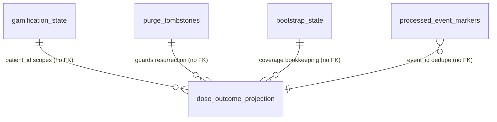

# LLD-MEDO-GAMIFICATION-001: Gamification Service — Harmony Points, Theme state, and outcome projection per Patient

## 1. Document control header

Gamification | backend-microservice | HLD-MEDO-GAMIFICATION-001@1.0 | approved

## 2. Design context and scope

### 2.1 Upstream HLD consumed

`HLD-MEDO-GAMIFICATION-001@1.0` (status: approved, `lld_readiness: pass`). Sections/blocks consumed by reference: §2 goals DG-GAM-1…7; §4 boundary statement + invariants; §5 all eleven blocks (`webapi-public`, `rate-limit`, `gamification-state-core`, `outcome-projection-core`, `scoring-core`, `bootstrap-orchestrator`, `event-consumer`, `account-deletion-consumer`, `schedule-dose-client`, `care-client`, `persistence`, `eventing`); §6 data architecture (`gamification_db` ownership, entity inventory, consistency model, retention); §7 external contracts (1 public REST row + 3 consumed internal reads); §8 events (zero published, 2 consumed) + workflows FIG-GAM-04-1…4; §9 frontend surface; §10 cross-cutting; §11 security; §12 deployment; §13 scaling; §14 failure/recovery/idempotency; §15 jobs (explicit none); §16 HD-GAM-01…06; §17 traceability; §18 OQ register (OQ-GAM-01/02, OQ-GAM-04, OQ-HLD-GAM-01/02 carried here; OQ-GAM-03/05 resolved upstream/out-of-scope).

### 2.2 Component place in system

The Gamification Service is the `medo-gamification` repository — one autonomous repo under GitHub owner `kiro-ai-bit` (`inherited:.scratch/medo-lld/issues/02-repo-shared-package-layout.md@2026-11-23`), built as the `gamification` container in the shared Docker Compose stack on AWS EC2 `t3.micro` (`inherited:HLD-MEDO-GAMIFICATION-001@1.0#12.1`). It realizes the HLD's eleven blocks as modules inside `Infrastructure/`, `Core/`, `Application/`, `WebAPI/` + `planning/` + `tests/` (Architecture Standard lines 169–218). It does NOT design: dose/schedule/outcome truth, classification, missed-lock, snooze, plan-skip (Schedule & Dose — consumed via two internal reads + `DoseOutcomeChanged` only), medicines/refills (Medicine — `MedicineArchived` deliberately unsubscribed), reminders/feed/prefs/push/email (Notification — zero interaction), Care Link lifecycle (Care — `check-link` consumed as caller only), accounts/profiles/directory (Identity — `AccountDeleted` consumed only, no directory reads), frontend widget/Dexie/refetch cadence (frontend LLD — API-only surface), or `@kiro-ai-bit/*` package internals.

### 2.3 Implementation goals

- LG-GAM-1: The single catalog route `GET /v1/patients/{id}/gamification` has a route module + handler signature + request/response DTO schema realized field-exact; the 3 consumed internal reads have client units + auth + failure bindings. [`service-catalog.md#gamification-service@2026-11-22`; HLD §7.1/§7.2]
- LG-GAM-2: `gamification_db` schema fully specified — patient state, outcome projection, purge tombstones, bootstrap state, processed-event markers, consumer offsets — with columns, constraints, indexes, migrations; no outbox table (publishes none). [HLD §6.1; `inherited:ticket-03`]
- LG-GAM-3: The scoring pipeline is implementable without decisions — projection latest-`occurredAt` upsert, ordered floor-0 replay + theme derive, bootstrap-before-apply ordering, once-per-gap-episode re-bootstrap, dose-detail fallback with `patientId` consistency check. [HD-GAM-02/03/04; FR-GAM-004…010]
- LG-GAM-4: Both consumed events have concrete dedup, reaction, and failure paths; `AccountDeleted` purge is one transaction with tombstone no-resurrection guard. [HD-GAM-05/06; FR-GAM-011/013]
- LG-GAM-5: Check-link authz is implementable — positive-only ≤15 s caller cache, negatives never cached, `AccountDeleted` invalidation, fail-closed mapping. [`inherited:ticket-09`; HD-GAM-05]
- LG-GAM-6: Zero scheduled jobs stated explicitly; consumer worker loop specified (poll/offset/retry/shutdown). [`scheduled-jobs.md@2026-11-21` zero-jobs row]
- LG-GAM-7: Shared-package bindings concrete — `@kiro-ai-bit/{eventing,rate-limit,contracts}` init points, observability counters, env surface. [`inherited:.scratch/medo-lld/issues/01-03`]
- LG-GAM-8: Carried OQs resolved or bound — bootstrap window bounds (OQ-GAM-02), equal-`occurredAt` tie-break (OQ-HLD-GAM-01), marker retention (OQ-HLD-GAM-02), recompute perf guard (OQ-GAM-04); consumed DTO names bound verbatim from Schedule & Dose LLD §6 (OQ-GAM-01 GAM side). [HLD §18.4]

### 2.4 Implementation non-goals

- `/v1/patients/{id}/doses`, `/v1/doses/{id}`, `/v1/doses/due`, `has-dose-records` production, `DoseOutcomeChanged` emission → Schedule & Dose LLD (consumed verbatim here §6/§7/§11).
- `check-link` semantics, Care Link lifecycle, event payload production → Care LLD.
- `AccountDeleted`/`UserRegistered`/`ProfileChanged`/auth-email payload production → Identity LLD.
- Widget rendering, refetch cadence, degraded-mode UX → Frontend LLD (`frontend-map.md` rows).
- `@kiro-ai-bit/*` package internals → `medo-shared` repo.
- Task sequencing/estimates → downstream `tasks` stage.
- Feed/milestone integration for points/theme → OQ-GAM-05, future map (out of scope).

### 2.5 Inherited decisions

- Runtime/framework Node.js + TypeScript + Fastify + Drizzle (`inherited:.scratch/medo-backend/issues/01-backend-runtime-framework.md@2026-11-20` — `jose`, `fastify-type-provider-zod` locked libs; no `node-cron` needed — zero jobs).
- Deployment: `gamification` container, Docker Compose on EC2, `.env` local / SSM prod (`inherited:…/02-deployment-model-hosting.md@2026-11-20`; `.scratch/medo-hld/issues/02-cicd-deploy-mechanism.md@2026-11-23`).
- DB: self-hosted Postgres, `gamification_db` + own DB user, `drizzle-kit` migrations (`inherited:…/03-database-technology.md@2026-11-21`).
- Object storage: not used — no R2 client (stated for completeness; `inherited:…/04-object-storage-provider.md@2026-11-21`).
- API gateway: Caddy public-route table — the single gamification route is the only exposed path (`inherited:…/05-api-gateway-entry-point.md@2026-11-21`).
- Auth: user JWTs verified locally via Identity JWKS; outbound service JWTs `iss=medo-gamification`, `aud=medo-schedule-dose|medo-care`, 5-min, minted per call (`inherited:…/06-auth-token-mechanics.md@2026-11-21`).
- Events: consumption only — `@kiro-ai-bit/eventing` sequential in-order consumer, own-DB `last_event_id` offsets, `eventId` dedupe, 5 attempts → `broker_db.dead_letters`; **no outbox table** (publishes none) (`inherited:…/07-message-broker-event-transport.md@2026-11-21`).
- Observability: Pino JSON + `X-Request-Id`/`eventId`; per-service `/metrics` `/health` `/ready`; Sentry `medo-gamification` (`inherited:…/08-observability.md@2026-11-21`; `platform-observability.md@2026-11-21`).
- Rate limits: auth'd reads 300/min/userId on the single route; no public-by-IP routes; internal exempt (none inbound) (`inherited:…/09-rate-limiting-caching.md@2026-11-21`).
- Caller-side cache: Care check-link positive-only ≤15 s TTL, negatives/invalid never cached; `AccountDeleted` invalidation (`inherited:…/09-rate-limiting-caching.md@2026-11-21`; HLD §10.4).
- HLD `HD-GAM-01…06` — all `accepted`; realized here.
- Error envelope `{error:{code,message,requestId,details?}}` — sibling convention (`inherited:docs/lld/medicine/LLD-MEDO-MEDICINE-001.md@1.0#LD-MED-10`; `OQ-LLD-SYS-01` pending ratification).
- Sibling LLD conventions: `docs/lld/{identity,care,medicine,schedule-dose,notification}/*.md` @1.0 — `@core|@application|@infrastructure|@webapi` aliases, `loadConfig` fail-fast, `consumer_offsets`/`processed_event_markers` shapes, check-link caller-cache pattern (LD-SCH-11/§8.12), conditional-UPDATE guards, injected `now: Date` clock.
- Consumed DTO/event contracts fixed upstream: `DoseSummaryDto`/`DoseDetailDto` field lists + service-token variants of `GET /v1/patients/{id}/doses`/`GET /v1/doses/{id}` (`inherited:docs/lld/schedule-dose/LLD-MEDO-SCHEDULE-DOSE-001.md@1.0#6` — resolves OQ-GAM-01 GAM side); `DoseOutcomeChanged` payload `{doseId, medicineId, patientId, outcome, actorId?, occurredAt}` + envelope `{eventId, occurredAt}` (catalog verbatim); `check-link` response `{active:boolean}` (`inherited:docs/lld/care/LLD-MEDO-CARE-001.md@1.0#6`); `AccountDeleted` payload `{userId}` (catalog verbatim).
- Baselines: `platform-quality-baseline.md@2026-11-21`, `platform-observability.md@2026-11-21`, `scheduled-jobs.md@2026-11-21` (Gamification row = zero jobs).

## 3. Repository structure and module map

### 3.1 Repository declaration (backend profile §4.1)

Repository: `medo-gamification` (public, MIT) under GitHub owner `kiro-ai-bit`; consumes `@kiro-ai-bit/{eventing,rate-limit,contracts,eslint-config,tsconfig,test-utils}` from GitHub Packages, exact-pinned + committed lockfile (`inherited:.scratch/medo-lld/issues/02@2026-11-23`). Logical namespaces: `Medo.Gamification.Infrastructure`, `Medo.Gamification.Core`, `Medo.Gamification.Application`, `Medo.Gamification.WebAPI`. Import convention (LD-GAM-01): path aliases `@core/*`, `@application/*`, `@infrastructure/*`, `@webapi/*` via `@kiro-ai-bit/tsconfig`; layer direction enforced by ESLint boundaries. `planning/` holds pointers to approved PRD/HLD/LLD. Bootstrap unit: `src/bootstrap.ts` → `buildApp()`.

```
medo-gamification/
├── Infrastructure/
│   ├── Persistence/        # schema/, repositories, consumer offsets, processed-event markers, tombstones
│   ├── Eventing/           # ensure-DDL, consumer worker config (no publisher)
│   ├── ScheduleDoseClient/ # doses window + dose detail calls (aud=medo-schedule-dose)
│   └── CareClient/         # check-link calls + positive-only cache + service-JWT mint
├── Core/
│   ├── GamificationState/  # {harmonyPoints, themeState, updatedAt} row rules + read DTO projection
│   ├── OutcomeProjection/  # per-doseId projection upsert, latest-occurredAt-wins
│   └── Scoring/            # ordered floor-0 replay + theme derivation (pure function)
├── Application/
│   ├── Bootstrap/          # first-sight/gap detection + doses pull + projection seed + episode state
│   ├── EventConsumer/      # 2 subscribed event types → dispatch table
│   └── AccountDeletion/    # AccountDeleted single-tx purge + tombstone
├── WebAPI/
│   ├── Public/             # 1 public Gamification route + platform surface
│   ├── Authn/              # user-JWT guard, error handler (no service-JWT inbound)
│   └── RateLimit/          # rate-limit binding
├── planning/               # pointers to approved docs
├── tests/{unit,integration,contract,e2e}/
└── src/bootstrap.ts
```

### 3.2 Module map

| Module ID | Responsibility | Physical path | Layer | HLD block | LD-ref |
|---|---|---|---|---|---|
| `webapi-public-routes` | `GET /v1/patients/{id}/gamification` + `/health` `/ready` `/metrics` platform surface | `WebAPI/Public/` | WebAPI | `webapi-public` | — |
| `webapi-authn` | user-JWT verify (JWKS), error handler; no service-JWT inbound exists | `WebAPI/Authn/` | WebAPI | `webapi-public` (shared guard) | LD-GAM-01/12 |
| `webapi-rate-limit` | rate-limit plugin registration + class bindings | `WebAPI/RateLimit/` | WebAPI | `rate-limit` | — |
| `core-gamification-state` | Patient state rules: single row per `patientId`, lazy-create defaults on first persisted recompute, upsert per recompute, read DTO `{harmonyPoints, themeState, updatedAt}` only | `Core/GamificationState/` | Core | `gamification-state-core` | LD-GAM-07 |
| `core-outcome-projection` | Per-`doseId` projection rules: upsert keyed `doseId` with latest-`occurredAt`-wins guard, `actorId` stored-never-scored, `patientId` consistency, outcome-enum filter (4 classes) | `Core/OutcomeProjection/` | Core | `outcome-projection-core` | LD-GAM-03/06 |
| `core-scoring` | Ordered floor-0 replay: sort `(scheduledAt, doseId)` → replay +10/−5/−10/−20 running `max(0,·)` clamp → theme derive as pure function of latest scheduled outcome | `Core/Scoring/` | Core | `scoring-core` | LD-GAM-11 |
| `app-bootstrap` | First-sight/gap detection + pull-bootstrap via Schedule & Dose + projection seed + gap-episode bookkeeping (`bootstrap_state`) | `Application/Bootstrap/` | Application | `bootstrap-orchestrator` | LD-GAM-04/05 |
| `app-event-consumer` | `@kiro-ai-bit/eventing` dispatch: `DoseOutcomeChanged` → tombstone/enum checks → maybe-bootstrap → projection upsert → recompute → persist; `AccountDeleted` → `app-account-deletion` | `Application/EventConsumer/` | Application | `event-consumer` | LD-GAM-05/13 |
| `app-account-deletion` | `AccountDeleted` reaction: single-tx purge of state + projection + marker scope + tombstone upsert; caregiver `userId` natural no-op on score tables | `Application/AccountDeletion/` | Application | `account-deletion-consumer` | LD-GAM-10 |
| `infra-schedule-dose-client` | `GET /v1/patients/{id}/doses?from=&to=&outcome=` (bootstrap) + `GET /v1/doses/{id}` (fallback); service-JWT `aud=medo-schedule-dose`; timeout/retry per baseline | `Infrastructure/ScheduleDoseClient/` | Infrastructure | `schedule-dose-client` | LD-GAM-04/06 |
| `infra-care-client` | `GET /v1/care/check-link?patientId=&caregiverId=` per caregiver read; positive-only ~15 s cache; negatives never cached; `AccountDeleted` invalidation | `Infrastructure/CareClient/` | Infrastructure | `care-client` | LD-GAM-08 |
| `infra-persistence` | Drizzle schema, repositories, consumer offsets, processed-event markers, purge tombstones, bootstrap state (no outbox) | `Infrastructure/Persistence/` | Infrastructure | `persistence` | LD-GAM-03/09 |
| `infra-eventing` | `@kiro-ai-bit/eventing` ensure-DDL + consumer worker (no publisher) | `Infrastructure/Eventing/` | Infrastructure | `eventing` | — |

HLD block → module coverage: `webapi-public`→webapi-public-routes/webapi-authn/webapi-rate-limit; `rate-limit`→webapi-rate-limit; `gamification-state-core`→core-gamification-state; `outcome-projection-core`→core-outcome-projection; `scoring-core`→core-scoring; `bootstrap-orchestrator`→app-bootstrap; `event-consumer`→app-event-consumer; `account-deletion-consumer`→app-account-deletion; `schedule-dose-client`→infra-schedule-dose-client; `care-client`→infra-care-client; `persistence`→infra-persistence; `eventing`→infra-eventing. Zero orphans both directions.

### 3.3 Bootstrap registration order (backend profile §4.1)

`buildApp()` registers: (1) `loadConfig` env validation — fail-fast (§13); (2) Pino logger + `X-Request-Id` hook; (3) error-handler plugin; (4) rate-limit plugin (`@kiro-ai-bit/rate-limit`); (5) user-JWT authN guard (Identity JWKS) — no service-JWT inbound surface exists; (6) Zod route registration (single route module); (7) `infra-eventing` ensure-DDL + consumer worker (`DoseOutcomeChanged` + `AccountDeleted` single dispatch) — **no `node-cron` scheduler exists** (zero jobs); (8) platform routes (`/health`, `/ready`, `/metrics`). Peer clients are instantiated lazily per call — no peer workers exist.

## 4. Module and unit detailed design

### 4.1 `webapi-public-routes`: the single public route + platform surface

| Unit | Kind | Signature | Responsibility | Depends on | Realizes |
|---|---|---|---|---|---|
| `registerGamificationRoutes` | function | `(app: FastifyInstance, deps: GamificationRouteDeps): Promise<void>` | Registers `GET /v1/patients/{id}/gamification` behind `userAuthGuard` + rate-limit + zod params | `core-gamification-state`, `infra-care-client` | §6 route row |
| `getGamificationState` | function | `(patientId: string, actor: UserClaims, deps: ReadDeps): Promise<GamificationStateDto>` | Authz (patient-self else check-link) → state read → DTO; absent row → defaults | `infra-care-client/checkLink`, `gamificationStateRepo` | FR-GAM-001…003/016 |
| `registerPlatformRoutes` | function | `(app: FastifyInstance, deps: PlatformDeps): Promise<void>` | Registers `/health`, `/ready` (deps: `gamification_db` + `broker_db` pings), `/metrics` (service-JWT gated) | `infra-persistence`, `infra-eventing` | §4.3 platform surface |

### 4.2 `webapi-authn`: guard + error handler

| Unit | Kind | Signature | Responsibility | Depends on | Realizes |
|---|---|---|---|---|---|
| `userAuthGuard` | function | `(request: FastifyRequest) => Promise<UserClaims>` | Verifies user access JWT via Identity JWKS/static config; rejects expired/invalid → `UNAUTHORIZED` | `jose` JWKS unit | HLD §10.1/§11.2 |
| `errorHandler` | function | `(error: Error, request: FastifyRequest, reply: FastifyReply) => void` | Single mapping point: thrown error class → status + `{error:{code,message,requestId,details?}}` | — | §14.1 |

No `serviceAuthGuard` exists — the service exposes zero internal routes (catalog verbatim).

### 4.3 `webapi-rate-limit`: rate-limit binding

| Unit | Kind | Signature | Responsibility | Depends on | Realizes |
|---|---|---|---|---|---|
| `registerRateLimit` | function | `(app: FastifyInstance): Promise<void>` | Registers `@kiro-ai-bit/rate-limit` plugin; binds auth'd-read class to the single route | `@kiro-ai-bit/rate-limit` | §12 class table |

### 4.4 `core-gamification-state`: patient state rules

| Unit | Kind | Signature | Responsibility | Depends on | Realizes |
|---|---|---|---|---|---|
| `getState` | function | `(patientId: string, now: Date): Promise<GamificationStateDto>` | Reads state row; absent → synthesized defaults `{0,'Harmony',null}` without write (LD-GAM-07) | `gamificationStateRepo` | FR-GAM-001c |
| `upsertRecomputed` | function | `(tx: DbTx, patientId: string, result: RecomputeResult, now: Date): Promise<void>` | Single-row upsert `{harmony_points, theme_state, updated_at=now}` — lazy-create on first persisted recompute | `gamificationStateRepo` | FR-GAM-008; HD-GAM-02 |
| `GamificationStateDto` | type | `{harmonyPoints: integer, themeState: 'Harmony'\|'Uneasy'\|'Horror', updatedAt: ISO-8601\|null}` | Boundary DTO — exactly three fields, no internal data | — | FR-GAM-001; DTO rule |

### 4.5 `core-outcome-projection`: per-dose projection rules

| Unit | Kind | Signature | Responsibility | Depends on | Realizes |
|---|---|---|---|---|---|
| `applyOutcomeEvent` | function | `(tx: DbTx, doseId: string, fields: ProjectionFields, occurredAt: ISO-8601): Promise<'applied'\|'stale'\|'inserted'>` | Upsert projection row for `doseId`; applies only when `incoming.occurredAt >= stored.occurredAt` (latest-wins; equal-`occurredAt` → sequential last-wins, LD-GAM-03); stores `actorId` for audit, never scored | `doseOutcomeProjectionRepo` | FR-GAM-005; HD-GAM-02 |
| `getProjection` | function | `(tx: DbTx, doseId: string): Promise<ProjectionRow \| null>` | Single-row read by PK | `doseOutcomeProjectionRepo` | consumer flow |
| `listProjectionForPatient` | function | `(tx: DbTx, patientId: string): Promise<ProjectionRow[]>` | All projection rows for replay input | `doseOutcomeProjectionRepo` | FR-GAM-006 |
| `seedProjectionRows` | function | `(tx: DbTx, patientId: string, rows: ProjectionSeed[]): Promise<number>` | Bulk upsert of bootstrap-seeded rows (same latest-wins guard) | `doseOutcomeProjectionRepo` | FR-GAM-009 |
| `patientHasProjection` | function | `(tx: DbTx, patientId: string): Promise<boolean>` | Existence check driving first-sight detection | `doseOutcomeProjectionRepo` | FR-GAM-009 |
| `ProjectionFields` | type | `{patientId: string, scheduledAt: ISO-8601, outcome: OutcomeClass, actorId?: string, occurredAt: ISO-8601}` | Projection write shape — minimal scoring fields only | — | HD-GAM-02 |
| `OutcomeClass` | type | `'taken-on-time' \| 'taken-late' \| 'skipped' \| 'missed'` | Closed 4-class enum — verbatim catalog | — | FR-GAM-004 |

### 4.6 `core-scoring`: ordered floor-0 replay + theme derive

| Unit | Kind | Signature | Responsibility | Depends on | Realizes |
|---|---|---|---|---|---|
| `recompute` | function | `(rows: ProjectionRow[], now: Date): RecomputeResult` | Pure function: sort `(scheduledAt ASC, doseId ASC)` → replay deltas `+10/-5/-10/-20` with running `max(0,total+delta)` → derive theme from latest scheduled outcome → `{harmonyPoints, themeState, updatedAt}` | — | FR-GAM-006/007/008; HD-GAM-03 |
| `DELTA_BY_OUTCOME` | constant | `Record<OutcomeClass, integer>` | `{taken-on-time:+10, taken-late:-5, skipped:-10, missed:-20}` verbatim Map 1 t10 | — | FR-GAM-006 |
| `themeForOutcome` | function | `(outcome: OutcomeClass): ThemeState` | `taken-on-time→Harmony`; `taken-late\|skipped→Uneasy`; `missed→Horror` | — | FR-GAM-007 |
| `RecomputeResult` | type | `{harmonyPoints: integer, themeState: ThemeState, updatedAt: ISO-8601}` | Persisted triple | — | FR-GAM-008 |
| `ThemeState` | type | `'Harmony' \| 'Uneasy' \| 'Horror'` | Closed enum | — | FR-GAM-007 |

### 4.7 `app-bootstrap`: first-sight/gap detection + pull-bootstrap

| Unit | Kind | Signature | Responsibility | Depends on | Realizes |
|---|---|---|---|---|---|
| `ensureProjectionCoverage` | function | `(patientId: string, doseId: string, eventOccurredAt: ISO-8601, deps: BootstrapDeps): Promise<'ready'\|'dose-detail-required'>` | Orchestrates first-sight bootstrap / once-per-episode gap re-bootstrap per §8.2–8.3; returns whether dose-detail fallback is still needed | `infra-schedule-dose-client`, `infra-persistence` (bootstrap_state + projection repos) | FR-GAM-009; HD-GAM-04 |
| `pullOutcomeHistory` | function | `(patientId: string, deps: BootstrapDeps): Promise<ProjectionSeed[]>` | Calls `GET /v1/patients/{id}/doses?from=&to=&outcome=` (epoch→now window, LD-GAM-04) → maps outcome-bearing `DoseSummaryDto`s to `ProjectionSeed[]` | `infra-schedule-dose-client/listPatientDoses` | FR-GAM-009 |
| `resolveUnseenDose` | function | `(doseId: string, expectedPatientId: string, deps: BootstrapDeps): Promise<ProjectionFields>` | Dose-detail fallback: `GET /v1/doses/{id}` → verify `patientId`/`medicineId` consistency → map to `ProjectionFields`; mismatch → throw `InvalidEventError` | `infra-schedule-dose-client/getDose` | FR-GAM-010 |
| `BootstrapDeps` | type | `{scheduleDose: ScheduleDoseClient, repos: BootstrapRepos, now: () => Date}` | Injected deps — clock + clients + repos | — | testability |

### 4.8 `app-event-consumer`: event dispatch

| Unit | Kind | Signature | Responsibility | Depends on | Realizes |
|---|---|---|---|---|---|
| `handleDoseOutcomeChanged` | function | `(event: DoseOutcomeChangedEvent, deps: ConsumerDeps): Promise<void>` | Dedup check → tombstone check → enum check → coverage ensure → projection upsert → recompute → state upsert + marker (§8.4) | `app-bootstrap`, `core-outcome-projection`, `core-scoring`, `core-gamification-state`, `infra-persistence` | FR-GAM-004…011; HD-GAM-02/03/04/05 |
| `handleAccountDeleted` | function | `(event: AccountDeletedEvent, deps: ConsumerDeps): Promise<void>` | Delegates to `app-account-deletion/purgePatient` | `app-account-deletion` | FR-GAM-013 |
| `dispatch` | function | `(event: BrokerEvent, deps: ConsumerDeps): Promise<void>` | Routes by `eventType`: `DoseOutcomeChanged` → `handleDoseOutcomeChanged`; `AccountDeleted` → `handleAccountDeleted`; unknown → skip (non-subscribed) | — | HD-GAM-05 |
| `ConsumerDeps` | type | `{repos: ConsumerRepos, bootstrap: BootstrapDeps, scoring, state, now: () => Date}` | Injected deps | — | testability |

### 4.9 `app-account-deletion`: `AccountDeleted` reaction

| Unit | Kind | Signature | Responsibility | Depends on | Realizes |
|---|---|---|---|---|---|
| `purgePatient` | function | `(userId: string, deps: DeletionDeps): Promise<void>` | Single tx: delete `gamification_state` + `dose_outcome_projection` rows for `patientId=userId` + scoped `processed_event_markers` + upsert `purge_tombstones`; caregiver `userId` deletes nothing (natural no-op on score tables) but still writes tombstone (LD-GAM-10) | `infra-persistence` repos | FR-GAM-013; HD-GAM-06 |

### 4.10 `infra-schedule-dose-client`: doses reads

| Unit | Kind | Signature | Responsibility | Depends on | Realizes |
|---|---|---|---|---|---|
| `listPatientDoses` | function | `(patientId: string, from: ISO-8601, to: ISO-8601): Promise<DoseSummaryDto[]>` | Internal `GET /v1/patients/{id}/doses?from=&to=` (no `outcome` param — all rows, Core filters); service-JWT `aud=medo-schedule-dose`; 3 s + 1 retry/200 ms (baseline internal-REST row); zod-parse response | `mintServiceJwt`, fetch | §11 consumed row 1 |
| `getDose` | function | `(doseId: string): Promise<DoseDetailDto>` | Internal `GET /v1/doses/{id}` service-token variant; same auth/timeout/retry; zod-parse | `mintServiceJwt`, fetch | §11 consumed row 2 |
| `mintServiceJwt` | function | `(aud: string): Promise<string>` | Mints 5-min service JWT `iss=medo-gamification`, `aud=medo-schedule-dose`, per call (`inherited:ticket-06`) | `SERVICE_PRIVATE_KEY` | §11 auth column |

### 4.11 `infra-care-client`: check-link + cache

| Unit | Kind | Signature | Responsibility | Depends on | Realizes |
|---|---|---|---|---|---|
| `checkLink` | function | `(patientId: string, caregiverId: string): Promise<boolean>` | Care `GET /v1/care/check-link` service-JWT call; positive-only ~15 s cache; negatives never cached; failure → throw `DependencyError` (§8.5) | `mintServiceJwt`, cache store | §11 consumed row 3; FR-GAM-002 |
| `invalidateForUser` | function | `(userId: string): void` | Purges all cache keys containing `userId` (both sides) — bound to `AccountDeleted` reaction | cache store | §8.5; `inherited:ticket-09` |
| `mintServiceJwt` | function | `(aud: string): Promise<string>` | Mints `aud=medo-care` token per call | `SERVICE_PRIVATE_KEY` | §11 auth column |

### 4.12 `infra-persistence`: schema + repositories

| Unit | Kind | Signature | Responsibility | Depends on | Realizes |
|---|---|---|---|---|---|
| `gamificationStateRepo` | repository | `getByPatient(tx, patientId)`, `upsert(tx, row)` | `gamification_state` reads/writes | drizzle schema §5.1 | §5.1 |
| `doseOutcomeProjectionRepo` | repository | `getByDoseId`, `listByPatientId`, `upsertLatestWins`, `seedBatch`, `existsForPatient`, `deleteByPatientId` | `dose_outcome_projection` CRUD with latest-`occurredAt` guard in SQL (`WHERE excluded.occurred_at >= dose_outcome_projection.occurred_at`) | drizzle schema §5.2 | §5.2; LD-GAM-03 |
| `purgeTombstoneRepo` | repository | `exists(patientId)`, `upsert(patientId, purgedAt)` | `purge_tombstones` guard reads/writes | drizzle schema §5.3 | §5.3 |
| `bootstrapStateRepo` | repository | `get(patientId)`, `upsertAfterBootstrap(...)`, `openGapEpisode(patientId)`, `closeGapEpisode(patientId)` | `bootstrap_state` bookkeeping per §8.3 | drizzle schema §5.4 | §5.4; LD-GAM-05 |
| `processedEventMarkerRepo` | repository | `has(eventId, action)`, `insert(eventId, action, patientId?, processedAt)`, `deleteOlderThan(cutoff, limit)`, `deleteByPatientId(patientId)` | `processed_event_markers` dedup + retention + purge scope | drizzle schema §5.5 | §5.5; LD-GAM-09/10 |
| `consumerOffsetRepo` | repository | `getLastEventId(consumer)`, `advance(consumer, eventId)` | `consumer_offsets` per `@kiro-ai-bit/eventing` contract | drizzle schema §5.6 | §5.6 |

### 4.13 `infra-eventing`: consumer machinery

| Unit | Kind | Signature | Responsibility | Depends on | Realizes |
|---|---|---|---|---|---|
| `ensureEventingSchema` | function | `(db: Db): Promise<void>` | Boot-time `@kiro-ai-bit/eventing` ensure-DDL for `consumer_offsets` participation + marker conventions | `@kiro-ai-bit/eventing` | §7.3 |
| `startConsumerWorker` | function | `(config: ConsumerConfig): Promise<ConsumerHandle>` | Starts sequential consumer for subscribed types `DoseOutcomeChanged`, `AccountDeleted`; poll 5 s; offset advances only after successful reaction commit; 5 attempts → `broker_db.dead_letters` | `@kiro-ai-bit/eventing` | §7.3; §10 worker loop |
| `ConsumerConfig` | type | `{consumer: 'gamification', events: 'broker_db.events', offsetTable: 'consumer_offsets', dispatch: (event, deps) => Promise<void>}` | Worker config | — | §7.3 |

## 5. Data model and persistence design

Owned store: `gamification_db` — sole ownership; never shared (`inherited:ticket-03`). PostgreSQL + Drizzle ORM + `drizzle-kit` migrations at deploy. `broker_db` schema owned by `@kiro-ai-bit/eventing` — cited, never redefined. **No outbox table exists** — the service publishes nothing (HLD §8.1 explicit).

### 5.1 `gamification_state`

One row per Patient — the single server-authoritative `{harmonyPoints, themeState, updatedAt}` state. Lazy-created on first persisted recompute; upserted per accepted event; purged on `AccountDeleted`. Owning unit: `core-gamification-state` via `gamificationStateRepo`.

| Column | Type | Nullable | Default | Constraints | Notes |
|---|---|---|---|---|---|
| `patient_id` | `uuid` | no | — | PK | Identity `userId` of Patient account; PII-adjacent reference |
| `harmony_points` | `integer` | no | — | CHECK `harmony_points >= 0` | lifetime cumulative, floor 0, no cap |
| `theme_state` | `text` | no | — | CHECK `theme_state IN ('Harmony','Uneasy','Horror')` | derived pure function of projection |
| `updated_at` | `timestamptz` | no | — | — | last persisted recompute commit time |
| `created_at` | `timestamptz` | no | `now()` | — | audit |

Constraints: PK `patient_id` enforces single-row-per-patient. No FK — cross-service IDs are opaque references (HLD §4.3).

| Index | Columns | Type | Purpose (serving query) |
|---|---|---|---|
| `gamification_state_pkey` | `(patient_id)` | btree (PK) | read route state lookup; purge delete |

### 5.2 `dose_outcome_projection`

Per-`doseId` scoring input — the ONLY projection store; not dose truth (NG-1). Upserted on first sight of `doseId` (event or bootstrap); latest-`occurredAt`-wins on conflict; purged on `AccountDeleted`. Owning unit: `core-outcome-projection` via `doseOutcomeProjectionRepo`.

| Column | Type | Nullable | Default | Constraints | Notes |
|---|---|---|---|---|---|
| `dose_id` | `uuid` | no | — | PK | Schedule & Dose dose identifier; opaque foreign reference |
| `patient_id` | `uuid` | no | — | NOT NULL | owning Patient `userId`; scopes replay + purge |
| `scheduled_at` | `timestamptz` | no | — | NOT NULL | ordering key — resolved at seed time (event payload lacks it); immutable per dose |
| `outcome` | `text` | no | — | CHECK `outcome IN ('taken-on-time','taken-late','skipped','missed')` | closed 4-class enum — verbatim catalog; `unmarked`/plan-skip never stored |
| `actor_id` | `uuid` | yes | `NULL` | — | attribution audit only — NEVER scored, NEVER in read DTO (PII flag) |
| `occurred_at` | `timestamptz` | no | — | NOT NULL | latest-wins comparison key — payload `occurredAt` for events, `markedAt ?? scheduledAt` for bootstrap seeds (LD-GAM-03/04) |
| `medicine_id` | `uuid` | yes | `NULL` | — | audit/context only — not scored; stored from event payload when present |
| `created_at` | `timestamptz` | no | `now()` | — | audit |
| `updated_at` | `timestamptz` | no | `now()` | — | audit |

Constraints: PK `dose_id` — one row per dose globally (doseIds are globally unique upstream). CHECK on `outcome` = closed enum. No FK — opaque references.

| Index | Columns | Type | Purpose (serving query) |
|---|---|---|---|
| `dose_outcome_projection_pkey` | `(dose_id)` | btree (PK) | per-dose upsert/get |
| `idx_projection_patient_sched` | `(patient_id, scheduled_at, dose_id)` | btree | `listProjectionForPatient` ordered replay input (§8.6) |
| `idx_projection_patient` | `(patient_id)` | btree | `patientHasProjection` first-sight check + `AccountDeleted` purge scan |

### 5.3 `purge_tombstones`

Resurrection guard — written inside the `AccountDeleted` purge tx; `event-consumer` checks before any `DoseOutcomeChanged` projection write for that `patientId`. Retained for account lifetime (zero jobs — no tombstone GC). Owning unit: `app-account-deletion` via `purgeTombstoneRepo`.

| Column | Type | Nullable | Default | Constraints | Notes |
|---|---|---|---|---|---|
| `patient_id` | `uuid` | no | — | PK | purged Patient `userId` |
| `purged_at` | `timestamptz` | no | — | — | `AccountDeleted` event `occurredAt` |

| Index | Columns | Type | Purpose (serving query) |
|---|---|---|---|
| `purge_tombstones_pkey` | `(patient_id)` | btree (PK) | tombstone existence check per event (O(1)) |

### 5.4 `bootstrap_state`

Per-patient bootstrap bookkeeping — drives first-sight detection, once-per-gap-episode re-bootstrap, and episode open/close transitions (LD-GAM-05). One row per bootstrapped `patientId`; purged on `AccountDeleted` (it is patient-scoped state). Owning unit: `app-bootstrap` via `bootstrapStateRepo`.

| Column | Type | Nullable | Default | Constraints | Notes |
|---|---|---|---|---|---|
| `patient_id` | `uuid` | no | — | PK | Patient `userId` |
| `first_bootstrap_at` | `timestamptz` | no | — | — | first successful pull completion |
| `last_bootstrap_at` | `timestamptz` | no | — | — | most recent pull completion (initial or gap re-bootstrap) |
| `bootstrap_count` | `integer` | no | `1` | CHECK `bootstrap_count >= 1` | bounded by episode rule — grows only on gap episodes |
| `gap_episode_open` | `boolean` | no | `false` | — | episode state machine flag (§8.3) |
| `gap_rebootstrap_used` | `boolean` | no | `false` | — | once-per-episode guard |
| `updated_at` | `timestamptz` | no | `now()` | — | audit |

| Index | Columns | Type | Purpose (serving query) |
|---|---|---|---|
| `bootstrap_state_pkey` | `(patient_id)` | btree (PK) | per-patient state read/write in consumer path |

### 5.5 `processed_event_markers`

Per-`(eventId, action)` dedup markers — sibling Notification pattern. `patient_id` retained for `AccountDeleted`-scoped purge; `processed_at` drives bounded retention (LD-GAM-09). Owning unit: `infra-persistence` via `processedEventMarkerRepo`.

| Column | Type | Nullable | Default | Constraints | Notes |
|---|---|---|---|---|---|
| `event_id` | `uuid` | no | — | PK part 1 | envelope `eventId` — at-least-once dedupe key |
| `action` | `text` | no | — | PK part 2 | marker vocabulary: `'dose-outcome-applied'`, `'account-deleted-purged'` (LD-GAM-13) |
| `patient_id` | `uuid` | yes | `NULL` | — | event's patient scope — enables purge-time marker cleanup; NULL for non-patient-scoped actions |
| `processed_at` | `timestamptz` | no | `now()` | — | retention cutoff basis |

Constraints: PK `(event_id, action)` — one marker per action per event.

| Index | Columns | Type | Purpose (serving query) |
|---|---|---|---|
| `processed_event_markers_pkey` | `(event_id, action)` | btree (PK) | dedup existence check per event |
| `idx_markers_processed_at` | `(processed_at)` | btree | bounded retention prune `deleteOlderThan` |
| `idx_markers_patient` | `(patient_id)` | btree | `AccountDeleted` marker purge scope |

### 5.6 `consumer_offsets`

Per-consumer `last_event_id` — `@kiro-ai-bit/eventing` contract shape (sibling-identical). Owning unit: `infra-eventing`/`infra-persistence`.

| Column | Type | Nullable | Default | Constraints | Notes |
|---|---|---|---|---|---|
| `consumer` | `text` | no | — | PK | consumer group name — `'gamification'` |
| `last_event_id` | `bigint` | no | `0` | — | advances only after successful reaction commit; never purged by `AccountDeleted` |
| `updated_at` | `timestamptz` | no | `now()` | — | audit |

| Index | Columns | Type | Purpose (serving query) |
|---|---|---|---|
| `consumer_offsets_pkey` | `(consumer)` | btree (PK) | offset read/advance per poll |

### 5.7 Migration & seed plan

Ordered `drizzle-kit` migrations (deploy-time; `@kiro-ai-bit/eventing` ensure-DDL covers only its own `broker_db` participation — `consumer_offsets` here is service-owned per sibling convention):

1. `001-gamification-state` — create `gamification_state`.
2. `002-dose-outcome-projection` — create `dose_outcome_projection` + indexes.
3. `003-purge-tombstones` — create `purge_tombstones`.
4. `004-bootstrap-state` — create `bootstrap_state`.
5. `005-processed-event-markers` — create `processed_event_markers` + indexes.
6. `006-consumer-offsets` — create `consumer_offsets`.

Seed data: none — all state is event/read-derived (lazy-create semantics). Ordering constraint: none beyond numeric order; all tables independent.

FIG-GAM-03 (optional): ER sketch



## 6. API endpoint realization

Inventory = 100% of HLD §7.1 rows: exactly one public route. Zero additions, zero omissions. No internal routes exist.

### GET /v1/patients/{id}/gamification

Route binding: `webapi-public-routes/getGamificationState` via `registerGamificationRoutes`. Middleware order (fixed once per service, §4.3 backend bindings): request-id → rate-limit (auth'd read 300/min/userId) → `userAuthGuard` (user JWT verify) → zod path-param validation → handler → error handler → response serialization.

Path param:

| Field | Type | Req | Constraints/Default | Notes |
|---|---|---|---|---|
| `id` | uuid | yes | valid UUID | `patientId` = Identity `userId` for Patient accounts (`frontend-map.md` patientId rule) |

No query params. No body (GET).

Response (200): `GamificationStateDto`

| Field | Type | Req | Constraints/Default | Notes |
|---|---|---|---|---|
| `harmonyPoints` | integer | yes | `>= 0`, no cap | lifetime cumulative floor-0 score |
| `themeState` | enum | yes | `'Harmony' \| 'Uneasy' \| 'Horror'` | derived from latest scheduled outcome |
| `updatedAt` | ISO-8601 \| null | yes | `null` iff no persisted recompute ever (LD-GAM-07) | last state mutation time |

Absent state row → `{harmonyPoints: 0, themeState: "Harmony", updatedAt: null}` (FR-GAM-001c; LD-GAM-07).

AuthZ binding (pointer, not re-decided): `patientId == session.sub` → allow; else session must be Caregiver with active Care Link → `infra-care-client/checkLink` per read (positive-only ≤15 s cache) — HLD §7.1/FR-GAM-001…003. Denial → `FORBIDDEN` with no existence/score leakage (FR-GAM-003c).

Errors: `UNAUTHORIZED` 401 (missing/invalid/expired JWT), `FORBIDDEN` 403 (non-patient non-linked-caregiver, cross-patient, malformed-but-valid-UUID unauthorized), `VALIDATION_FAILED` 400 (non-UUID `id`), `DEPENDENCY_UNAVAILABLE` 503 (own-DB fast-fail; check-link failure → fail closed deny/503), `RATE_LIMITED` 429 (+`Retry-After`), `INTERNAL` 500. Non-GET methods → 404/405 (route registers GET only — FR-GAM-015).

Idempotency: n-a (read-only; no writes exist — FR-GAM-015/012). Validation split: zod validates path-param UUID shape at WebAPI; Core validates nothing further on this route (no body); authz rule lives in `getGamificationState` (Application-adjacent orchestration inside WebAPI handler per sibling pattern).

### Platform surface

`GET /health` → 200 `{status:"ok"}` (public). `GET /ready` → 200 `{status:"ready"}` or 503 — deps: `gamification_db` ping + `broker_db` ping (HLD §10.2/§12.5; upstream REST NOT a readiness dep). `GET /metrics` → Prometheus text, service-JWT gated (internal-exempt; unreachable via Caddy public table).

### Backend profile §4.3 bindings

Fastify schema-first registration: the `GamificationStateDto` response schema + path-param schema authored as zod in `@kiro-ai-bit/contracts` (Gamification route schema per ticket-03) compiled via `fastify-type-provider-zod`; Core re-validates domain invariants where applicable. Error handler = `webapi-authn/errorHandler` single mapping point (§14). `/health` `/ready` `/metrics` are contract surface specified above.

## 7. Event realization

### 7.1 Published events

**None — explicit per catalog** ("Publishes: none; no `PointsChanged`/`ThemeChanged` — no consumer exists"). `gamification_db` contains no outbox table; `infra-eventing` runs consumer machinery only. No Gamification action produces a `broker_db.events` row — score propagation to clients happens exclusively via the read API + frontend refetch (`frontend-map.md`).

### 7.2 Consumed events

Both subscriptions flow through `infra-eventing/startConsumerWorker` → `app-event-consumer/dispatch`; sequential in-order per `@kiro-ai-bit/eventing`; every applied event dedupes per `eventId` via `processed_event_markers`; failures retry 5 attempts → `broker_db.dead_letters`, manual replay only.

| Event | Consumer unit | Dedupe guard | Offset/retry |
|---|---|---|---|
| `DoseOutcomeChanged` | `infra-eventing` dispatch → `app-event-consumer/handleDoseOutcomeChanged` | `processed_event_markers` PK `(event_id,'dose-outcome-applied')` + per-`doseId` latest-`occurredAt` projection guard | `consumer_offsets.last_event_id` advance-after-commit; sequential in-order; 5 attempts → `dead_letters`; manual replay |
| `AccountDeleted` | `infra-eventing` dispatch → `app-event-consumer/handleAccountDeleted` → `app-account-deletion/purgePatient` | `processed_event_markers` PK `(event_id,'account-deleted-purged')` + tombstone upsert idempotency | same offset/retry semantics |

`DoseOutcomeChanged` payload (verbatim catalog + SCH LLD §7): envelope `{eventId, occurredAt}` + `{doseId: uuid, medicineId: uuid, patientId: uuid, outcome: 'taken-on-time'|'taken-late'|'skipped'|'missed', actorId?: uuid, occurredAt: ISO-8601}`. The payload-level `occurredAt` is the domain ordering timestamp used for latest-wins (LD-GAM-03); envelope `occurredAt` is broker metadata.

`AccountDeleted` payload: envelope `{eventId, occurredAt}` + `{userId: uuid}`.

### 7.3 Explicit none-statements

- Publishes **zero** events — no outbox table exists in `gamification_db` (HLD §8.1/§8.3).
- `MedicineArchived` deliberately NOT subscribed — archived medicines' historical outcomes remain in the projection (lifetime score is history; HLD §8.3).
- `CareLinkEnded` and all other Care events NOT subscribed — zero link state stored; check-link ≤15 s positive TTL is the entire revocation bound (HLD §8.3/§10.4).
- `UserRegistered`/`ProfileChanged`/`EmailVerificationRequested`/`PasswordResetRequested`/`RefillThresholdCrossed` NOT subscribed — no scoring or authz relevance.
- Snooze and `skippedByUser` plan-skip produce no `DoseOutcomeChanged` upstream (4-class enum only); FR-GAM-004 ignores any non-enum value defensively — zod validation failure → failed attempt → `dead_letters`.
- No reminder/due/feed/push events exist in either direction.

### 7.4 `@kiro-ai-bit/eventing` bindings

- `ensureEventingSchema(db)` — boot step 7 (`infra-eventing/ensureEventingSchema`); `consumer_offsets` participation per package contract (service-owned table §5.6 per sibling convention).
- `createConsumerWorker({consumer:'gamification', events:'broker_db.events', offsetTable:'consumer_offsets', dispatch})` — capability-level signature; package owns sequential poll (5 s), offset-after-success, 5 attempts → `dead_letters`, at-least-once delivery.
- Envelope/zod schemas imported for `DoseOutcomeChanged` + `AccountDeleted` (consumed); event names verbatim PascalCase; no publisher worker exists.
- Per-consumer dispatch table: `| DoseOutcomeChanged | handleDoseOutcomeChanged | marker (event_id,'dose-outcome-applied') | offset advances post-commit |`; `| AccountDeleted | handleAccountDeleted | marker (event_id,'account-deleted-purged') + tombstone | offset advances post-commit |`. Skip-non-subscribed: consumer filters its own subscribed `eventType`s only.

## 8. Algorithms and business-rule logic

Pseudocode dialect: intent-level steps, named §4 units, explicit ordering/error branches. All ordering math is instant-based (`timestamptz`) — deterministic: identical projection contents always produce identical `{harmonyPoints, themeState}` (DG-GAM-1).

### 8.1 Ordered floor-0 recompute + theme derive (`core-scoring/recompute`) — FR-GAM-006/007/008, HD-GAM-03

Purpose: pure function mapping a patient's full outcome projection to `{harmonyPoints, themeState}`. I/O: `ProjectionRow[]` → `RecomputeResult`. Complexity: O(n log n) sort + O(n) replay per event — trivial at envelope (<5k dose events/day, per-patient histories in the hundreds; `platform-quality-baseline.md`); no incremental caching in v1 (LD-GAM-11).

```
recompute(rows, now):
  sorted = rows.sort by (scheduledAt ASC, doseId ASC)          # deterministic total order — tie-break doseId
  total = 0
  latestOutcome = null
  for row in sorted:                                          # replay in scheduled order
      total = max(0, total + DELTA_BY_OUTCOME[row.outcome])    # running floor-0 clamp — non-invertible, hence full replay
      latestOutcome = row.outcome                              # last iteration = latest scheduledAt (ties broken by doseId — deterministic)
  theme = latestOutcome == null ? 'Harmony' : themeForOutcome(latestOutcome)
  return {harmonyPoints: total, themeState: theme, updatedAt: now}
```

Invariants: identical input rows → identical output (purity — same projection ⇒ same result every run/restart); `harmonyPoints >= 0` always (CHECK + clamp); zero rows → `{0,'Harmony'}`; theme is a pure function of the latest scheduled outcome — no separate state machine.

### 8.2 First-sight bootstrap (`app-bootstrap/ensureProjectionCoverage` + `pullOutcomeHistory`) — FR-GAM-009, HD-GAM-04

Purpose: seed the projection with the patient's full outcome-bearing dose history BEFORE the triggering event is applied — bootstrap-before-apply. I/O: `(patientId, doseId)` → coverage decision. All upstream pulls complete BEFORE any local write; sequential consumer guarantees no second event interleaves.

```
ensureProjectionCoverage(patientId, doseId, eventOccurredAt):
  state = bootstrapStateRepo.get(patientId)                    # outside tx — peer I/O precedes local writes
  if state == null:                                            # FIRST SIGHT — never bootstrapped
      seeds = pullOutcomeHistory(patientId)                    # throws DependencyError on upstream failure → event retries, zero writes
      tx: seedProjectionRows(patientId, seeds)                 # upsert, latest-wins guard — idempotent under redelivery
          bootstrapStateRepo.upsertAfterBootstrap(patientId, count=seeds.length, gapEpisodeOpen=false)
      return 'ready'
  # bootstrapped before — check doseId coverage
  if projectionRepo.exists(doseId): return 'ready'             # covered — normal path
  # doseId absent → gap handling per §8.3
  return handleGap(patientId, doseId, eventOccurredAt, state)
```

`pullOutcomeHistory` mechanics (LD-GAM-04): calls `listPatientDoses(patientId, from='1970-01-01T00:00:00.000Z', to=now)` — single unpaginated response per Schedule & Dose §6 contract (no cursor on this route); maps each `DoseSummaryDto` with `outcome != 'unmarked'` to `ProjectionSeed{doseId: dto.id, patientId: dto.patientId, scheduledAt: dto.scheduledAt, outcome: dto.outcome, actorId: dto.actorId ?? undefined, occurredAt: dto.markedAt ?? dto.scheduledAt, medicineId: dto.medicineId}`; doses with no outcome contribute nothing (FR-GAM-009c). `scheduledAt`/`markedAt` are ISO-8601 strings in the DTO — stored as `timestamptz`.

### 8.3 Gap-episode state machine (`app-bootstrap` + `bootstrap_state`) — FR-GAM-009/010, HD-GAM-04, resolves OQ-HLD-GAM-01-adjacent bookkeeping

Purpose: bound re-bootstrap to once per gap episode; fall back to dose-detail for post-bootstrap doses. Episode = maximal run of consecutive gap events for a `patientId`; opens on first absent-`doseId`, closes when an event's `doseId` is found in the projection.

Transition table:

| From | Event/Command | To | Side effects | Guard |
|---|---|---|---|---|
| no `bootstrap_state` row | first `DoseOutcomeChanged` for patientId | bootstrapped (`gap_episode_open=false`) | full pull + seed + upsert state | §8.2 first-sight |
| `gap_episode_open=false`, doseId absent | gap event | `gap_episode_open=true`, `gap_rebootstrap_used=true` | ONE full re-pull + seed (same idempotent upsert) | once per episode |
| `gap_episode_open=true`, doseId absent | gap event | unchanged | NO re-pull — straight to dose-detail | once-per-episode guard |
| any, doseId present in projection | normal event | `gap_episode_open=false`, `gap_rebootstrap_used=false` (if was open) | episode closed | — |
| doseId still absent after re-bootstrap | gap event | dose-detail fallback | `GET /v1/doses/{id}` → verify → insert | §8.4 step |

```
handleGap(patientId, doseId, eventOccurredAt, state):
  if !state.gap_episode_open:
      openGapEpisode(patientId)                                     # gap_episode_open=true, gap_rebootstrap_used=true
      seeds = pullOutcomeHistory(patientId)                        # failure → throw → event retries (FR-GAM-009b)
      tx-lite: seedProjectionRows(patientId, seeds)                # idempotent upsert — NO state row write, NO marker
      if projectionRepo.exists(doseId): return 'ready'             # gap resolved by re-pull
  # episode open or still absent → dose-detail fallback
  fields = resolveUnseenDose(doseId, patientId)                    # §8.4 — failure → throw → event retries (FR-GAM-010)
  tx-lite: applyOutcomeEvent-lite insert for doseId                # or defer to main tx — see §8.4/§9
  return 'ready'
```

Note: gap re-pull and dose-detail inserts happen BEFORE the main reaction tx (§9) — peer I/O and seed writes are pre-transaction orchestration per HLD §4.3/HD-GAM-04; the triggering event's own projection upsert + recompute + state + marker still commit atomically in the main tx.

### 8.4 `DoseOutcomeChanged` reaction (`app-event-consumer/handleDoseOutcomeChanged`) — FR-GAM-004…011, HD-GAM-02/05

Purpose: the complete per-event pipeline. I/O: `DoseOutcomeChangedEvent` → void (throws → consumer retry).

```
handleDoseOutcomeChanged(event):
  # 1. dedup — marker check OUTSIDE tx (read-only)
  if markerRepo.has(event.eventId, 'dose-outcome-applied'): return  # at-least-once redelivery → no-op
  # 2. tombstone guard — post-purge resurrection block (HD-GAM-06)
  if tombstoneRepo.exists(event.patientId):
      tx: markerRepo.insert(event.eventId, 'dose-outcome-applied', patientId=event.patientId, now)
      return                                                        # ignored, counted — NOT failed
  # 3. outcome enum gate — closed 4-class set (FR-GAM-004)
  if event.outcome not in OUTCOME_CLASSES: throw SchemaValidationError   # → failed attempt → dead_letters after 5
  # 4. coverage — first-sight / gap / dose-detail (§8.2–8.3)
  coverage = ensureProjectionCoverage(event.patientId, event.doseId, event.payload.occurredAt)
  # coverage may have inserted the doseId row already (bootstrap seed or dose-detail)
  # 5. MAIN TX — projection + recompute + state + marker atomic (§9)
  tx:
      applied = projectionRepo.upsertLatestWins(event.doseId, {
          patientId: event.patientId, scheduledAt: <resolved>,       # from existing row or §8.3-resolved fields
          outcome: event.outcome, actorId: event.actorId,
          occurredAt: event.payload.occurredAt, medicineId: event.medicineId})
      # upsertLatestWins guard: applies iff incoming.occurredAt >= stored.occurredAt
      #   (equal → sequential consumer order decides — deterministic last-wins; same eventId already deduped)
      if applied == 'stale':                                        # older occurredAt redelivery — projection unchanged
          recompute still runs? NO — see note below
      rows = projectionRepo.listByPatientId(event.patientId)        # inside tx — consistent replay input
      result = scoringCore.recompute(rows, now)                     # §8.1 pure function
      stateCore.upsertRecomputed(tx, event.patientId, result, now)  # lazy-create on first persist
      markerRepo.insert(event.eventId, 'dose-outcome-applied', patientId=event.patientId, now)
      if bootstrapStateRepo.get(event.patientId)?.gap_episode_open: # episode close on covered doseId
          bootstrapStateRepo.closeGapEpisode(event.patientId)
  commit → consumer offset advances (eventing machinery)
```

Stale-`occurredAt` note: when `upsertLatestWins` returns `'stale'` (incoming older than stored — defensive out-of-order `occurredAt`, FR-GAM-011), the projection did NOT change; recompute over unchanged rows yields the identical result — running it is harmless but wasteful. Decision (LD-GAM-03): still run recompute + state upsert + marker inside the same tx for uniformity — the result is deterministic and the marker MUST be written regardless (dedup obligation). Cost is one extra O(n) replay on a rare path — accepted for simplicity; metric `recompute_total` counts it.

ScheduledAt resolution: the event payload carries NO `scheduledAt` (catalog payload has none — HD-GAM-04). The projection row's `scheduled_at` is therefore supplied by: (a) bootstrap seed (`DoseSummaryDto.scheduledAt`), (b) dose-detail fallback (`DoseDetailDto.scheduledAt`), or (c) the already-existing projection row (subsequent events for a known doseId). `upsertLatestWins` on an existing row NEVER overwrites `scheduled_at`/`patient_id` (immutable per dose — verified upstream at seed time); on insert it requires resolved fields — guaranteed non-null by §8.2/§8.3 coverage step.

### 8.5 Check-link caller cache (`infra-care-client/checkLink`) — FR-GAM-002, `inherited:ticket-09` binding

```
key = `${patientId}:${caregiverId}`
hit = checkLinkCache.get(key)  → if fresh (<15000ms) return true         # positives only
miss: call Care GET /v1/care/check-link?patientId=&caregiverId= (service JWT aud=medo-care,
      3s timeout + 1 retry/200ms — baseline internal-REST row)
  {active:true}  → checkLinkCache.set(key); return true
  {active:false} → return false WITHOUT caching                          # negatives never cached
  error/timeout  → throw DependencyError → route maps DEPENDENCY_UNAVAILABLE (fail closed)
```

Invalidation: `AccountDeleted` reaction → `invalidateForUser(userId)` purges all keys containing `userId` (both `patientId:` and `caregiverId:` positions) — called post-commit in `app-account-deletion/purgePatient` wrapper. `CareLinkEnded` NOT subscribed (catalog) → ended-link answers possible ≤15 s — documented instant-revoke bound (HLD §10.4). In-process `Map` only — single-instance assumption (HLD §12.4/§13).

### 8.6 Patient dose-window read — N/A note

This service has no dose-window read of its own; `listProjectionForPatient` (§4.5) is the replay input — ordering guaranteed by `idx_projection_patient_sched` `(patient_id, scheduled_at, dose_id)` matching the §8.1 sort key exactly, so the repository may return pre-ordered rows; `recompute` still sorts defensively (pure function contract).

### 8.7 `AccountDeleted` reaction (`app-account-deletion/purgePatient`) — FR-GAM-013, HD-GAM-06

```
purgePatient(userId):
  tx:
      gamificationStateRepo.deleteByPatientId(userId)          # state row — zero rows remain for score tables
      doseOutcomeProjectionRepo.deleteByPatientId(userId)      # entire projection
      markerRepo.deleteByPatientId(userId)                     # scoped marker cleanup (LD-GAM-10)
      bootstrapStateRepo.deleteByPatientId(userId)             # patient-scoped bookkeeping
      tombstoneRepo.upsert(userId, purgedAt=event.occurredAt)  # resurrection guard — ALWAYS written (LD-GAM-10)
      markerRepo.insert(event.eventId, 'account-deleted-purged', patientId=userId, now)
  commit → invalidateForUser(userId) on care-client cache (post-commit, outside tx)
```

Caregiver `userId`: deletes nothing on score tables (no rows exist — natural no-op per AC-GAM-013b); tombstone + marker still written — harmless: that `userId` can never appear as `patientId` in `DoseOutcomeChanged` (one role per account, Map 1 t01) so the tombstone guards nothing real but keeps the code path uniform (LD-GAM-10). Redelivery: marker dedup → no-op; tombstone upsert idempotent.

### 8.8 Business-rule placement summary

| Rule | Enforcing unit + layer |
|---|---|
| Floor-0 clamp, delta table, theme mapping, sort order | `core-scoring` (Core — pure domain rule) |
| Latest-`occurredAt`-wins, `actorId` never scored, enum filter, `scheduledAt` immutability | `core-outcome-projection` (Core) + DB CHECK/PK (Infrastructure) |
| First-sight/gap/episode orchestration, dose-detail consistency | `app-bootstrap` (Application workflow) |
| Dedup, tombstone guard, enum gate, tx assembly, marker writes | `app-event-consumer` (Application) |
| Purge scope + tombstone write | `app-account-deletion` (Application) + DB constraints |
| Authz (self vs check-link), DTO shape, defaults | `webapi-public-routes/getGamificationState` (WebAPI orchestration) + `core-gamification-state` |
| Upstream DTO→projection mapping | `app-bootstrap/pullOutcomeHistory`, `resolveUnseenDose` (Application) |

## 9. Transaction boundaries and consistency

| Write path | Tx boundary contents | Outbox rows same-tx | Peer calls (outside tx) | Commit/rollback | Idempotency guard |
|---|---|---|---|---|---|
| `DoseOutcomeChanged` consume (main reaction) | projection upsert + `listByPatientId` + state upsert + processed marker (+ gap-episode close) — ONE `gamification_db` tx | none — publishes nothing | bootstrap pulls + dose-detail ALL complete BEFORE tx begins (HD-GAM-04) | rollback → event not applied → consumer retry → 5 attempts → `dead_letters`; offset advances only post-commit | `processed_event_markers` PK `(event_id,'dose-outcome-applied')` + projection latest-`occurredAt` guard |
| Bootstrap seed writes (first-sight / gap re-pull) | `seedProjectionRows` batch upsert + `bootstrap_state` upsert — small dedicated tx (or autocommit per statement group) | none | the doses pull itself | failure → throw before/with tx → event retries; partial seed impossible — upsert batch is one tx | upsert latest-wins — re-run converges to same projection |
| Dose-detail insert (unseen doseId) | single projection row insert — dedicated small tx before main tx | none | `GET /v1/doses/{id}` | failure → throw → event retries | PK `dose_id` + latest-wins guard |
| `AccountDeleted` consume | state delete + projection delete + marker-scope delete + bootstrap-state delete + tombstone upsert + processed marker — ONE tx | none | none (pure local) | rollback → redelivery retries; atomic — no partial purge | marker PK `(event_id,'account-deleted-purged')` + tombstone upsert idempotent |
| Read route | none — read-only | — | check-link call BEFORE state read (outside any tx — reads need none) | n-a | natural — absent row → deterministic defaults |

Isolation/locking: no `SELECT FOR UPDATE` needed — single consumer is the ONLY writer to projection/state tables (sequential `@kiro-ai-bit/eventing` offsets serialize all writes); reads are last-committed-wins (accepted stale bound = one event latency, PRD §8). Concurrency points and mechanisms: per-`doseId` conflicts → PK + `occurred_at >=` guard in upsert SQL; per-`patientId` state → PK upsert; per-`eventId` → marker PK; per-consumer order → `consumer_offsets` row advance-after-commit. `AccountDeleted` vs in-flight `DoseOutcomeChanged`: sequential consumer serializes them in broker order — if outcome event commits first, purge tx deletes it; if purge commits first, tombstone blocks the later event (HD-GAM-06 — no interleaving possible inside one consumer).

## 10. Scheduled jobs and background processing

**No scheduled jobs — explicit per `scheduled-jobs.md@2026-11-21`** (Medicine/Gamification row = "none"). Zero `node-cron` registrations exist; `package.json` has no scheduler dependency usage; all state changes are event-driven (consumer poll loop — not a scheduled job) or read-time. Inventory diff = zero.

| Job | Cadence | Unit | Reads | Writes | Events | Failure | Metric |
|---|---|---|---|---|---|---|---|
| no scheduled jobs | — | — | — | — | — | — | — |

### Worker loops

`infra-eventing/startConsumerWorker` — the ONLY background loop: sequential poll of `broker_db.events` every 5 s (`@kiro-ai-bit/eventing` internals); per-event dispatch via `app-event-consumer/dispatch`; `consumer_offsets.last_event_id` advances ONLY after the reaction tx commits; per-event failure → attempt counter → 5 attempts → `broker_db.dead_letters` (manual replay — platform `broker-watchdog` owned by Notification service observes lag, this service does not subscribe); poison/malformed payload → zod validation failed attempt → same DLQ path; shutdown = stop polling, in-flight event completes or rolls back (offset un-advanced → redelivered idempotently on restart). No publisher worker exists (publishes none). No job reentrancy guard needed — no jobs exist; consumer is single-loop by construction.

## 11. Integration clients and cross-service calls

| Contract | Client unit | Auth | Timeout/retry (cite) | Cache | Failure binding |
|---|---|---|---|---|---|
| `GET /v1/patients/{id}/doses?from=&to=&outcome=` (internal service-token variant) | `infra-schedule-dose-client/listPatientDoses` | service-JWT `aud=medo-schedule-dose`, `iss=medo-gamification`, 5-min minted per call | 3 s + 1 retry/200 ms — `platform-quality-baseline.md#resilience-defaults` internal-REST row | none — one-shot correctness input per gap episode (HLD §10.4) | §14 row SCH-DOSES — throw `DependencyError` → event not applied → consumer retry → DLQ |
| `GET /v1/doses/{id}` (internal service-token variant) | `infra-schedule-dose-client/getDose` | service-JWT `aud=medo-schedule-dose` | same baseline row | none — per-event fallback | §14 row SCH-DOSE-DETAIL — same retry path; 404 → `InvalidEventError` → DLQ (dose does not exist upstream) |
| `GET /v1/care/check-link?patientId=&caregiverId=` | `infra-care-client/checkLink` | service-JWT `aud=medo-care` | same baseline row | positive-only ≤15 s TTL `Map<patientId:caregiverId,{expiresAt}>`; negatives/invalid never cached; `AccountDeleted` → `invalidateForUser` (§8.5) | §14 row CARE-CHECKLINK — fail closed `DEPENDENCY_UNAVAILABLE` 503 |

Response handling: all three responses zod-parsed at client boundary (`@kiro-ai-bit/contracts` internal DTO schemas stay per-service per ticket-03 — these are consumed contract types authored in Schedule & Dose/Care repos' contract surface; the client validates shape defensively). `listPatientDoses` consumes `DoseSummaryDto` fields `{id, patientId, scheduledAt, outcome, actorId, markedAt, medicineId}` verbatim per SCH LLD §6; `getDose` consumes `DoseDetailDto` (= `DoseSummaryDto` + `{createdAt, updatedAt}`); `checkLink` consumes `{active: boolean}` per Care LLD §6.

### Internal surface verification spec

**Zero inbound internal surface** — the service exposes no internal REST routes (catalog: "Internal REST — None — read API only; no service callers"). `/metrics` is service-JWT gated per platform convention but is platform surface, not a domain route; no `serviceAuthGuard` domain routes are registered. Defense-in-depth statement: the single public route is unreachable for service-token semantics (user-JWT guard rejects non-user tokens) AND absent from any internal caller set — nothing calls in.

### JWKS verification unit

`webapi-authn/userAuthGuard` — verifies user access JWTs locally via Identity JWKS fetched/cached per `inherited:ticket-06` (verify locally, no per-request call; key-rotation tolerance via JWKS refresh on unknown `kid`). No service-JWT verification unit exists (no inbound service routes). Outbound service JWTs are minted, never verified, here.

## 12. Shared packages and platform bindings

| Package/mechanism | API surface used | Init point | Config keys |
|---|---|---|---|
| `@kiro-ai-bit/eventing` | `ensureEventingSchema()`, `createConsumerWorker(config)` | `infra-eventing` bootstrap step 7 | `BROKER_DATABASE_URL` DSN env |
| `@kiro-ai-bit/rate-limit` | `registerRateLimit(app, config)` plugin | `webapi-rate-limit` bootstrap step 4 | class table below |
| `@kiro-ai-bit/contracts` | zod DTO schemas — `GamificationStateDto` response + path-param (request validation via `fastify-type-provider-zod`); consumed-contract parse schemas referenced per-service | route registration §6 | — |
| `jose` | `jwtVerify` (JWKS), `SignJWT` (service tokens) | `webapi-authn`, client minters | `IDENTITY_JWKS_URL`, `SERVICE_PRIVATE_KEY` |
| `drizzle-orm` + `drizzle-kit` | schema/repositories/migrations | `infra-persistence` | `DATABASE_URL` (`gamification_db`) |
| Pino | Fastify `logger: true` | bootstrap step 2 | — |
| `@sentry/node` | init + capture | bootstrap step 2 | `SENTRY_DSN` |

Packages NOT used (stated for completeness): `node-cron` (zero jobs), `web-push`, `resend`, AWS S3/R2 client — no provider integrations exist.

Rate-limit route-class table (`inherited:…/09-rate-limiting-caching.md@2026-11-21`):

| Route group | Class | Override? |
|---|---|---|
| `GET /v1/patients/{id}/gamification` | auth'd read 300/min/userId | — |
| `/health`, `/ready`, `/metrics` | internal-exempt | — |

No public-by-IP routes exist (route is session-scoped patient route — FR-GAM-015 surface). No auth'd-write class exists (zero write routes).

Observability binding (`platform-observability.md@2026-11-21` + PRD NFR-GAM-06 deltas): Pino JSON `service=gamification`, `requestId`/`eventId` correlation; logs carry `patientId`/`doseId`/`eventId` correlation IDs only — never emails, names, medicine names, or clinical detail (NFR-GAM-05); `/metrics` counters: RED set + `medo_gamification_reads_total{result=ok|denied}`, `medo_gamification_checklink_total{result=hit|miss|active|inactive|error}`, `medo_gamification_events_consumed_total{type=dose-outcome|account-deleted}`, `medo_gamification_dedup_hits_total`, `medo_gamification_recompute_total`, `medo_gamification_recompute_duration_ms` (histogram), `medo_gamification_bootstrap_total{result=ok|error|skipped}`, `medo_gamification_projection_rows_seeded_total`, `medo_gamification_dose_detail_fallback_total{result=ok|mismatch|error}`, `medo_gamification_tombstone_blocks_total`, `medo_gamification_dead_letters` gauge, consumer lag gauge. `/ready` deps: `gamification_db` ping + `broker_db` ping (upstream REST explicitly NOT a dep). Sentry project `medo-gamification`.

## 13. Configuration, secrets and environment

| Var | Consumer unit | Purpose | Local source | Prod source | Required? |
|---|---|---|---|---|---|
| `DATABASE_URL` | `infra-persistence` | `gamification_db` DSN (own user) | `.env` | SSM | yes |
| `BROKER_DATABASE_URL` | `infra-eventing` | `broker_db` access for consumer | `.env` | SSM | yes |
| `IDENTITY_JWKS_URL` | `webapi-authn` | user-JWT verify endpoint | `.env` | SSM | yes |
| `SERVICE_PRIVATE_KEY` | client JWT minters | sign `aud=medo-schedule-dose`/`aud=medo-care` service JWTs | `.env` | SSM | yes |
| `SENTRY_DSN` | bootstrap | error tracking | `.env` | SSM | yes |
| `PORT` | bootstrap | listen port | `.env` | compose | yes |
| `NODE_ENV` | bootstrap | env mode | `.env` | compose | yes |

Env-validation unit: `loadConfig()` zod schema — fail-fast at boot listing missing/invalid vars (sibling pattern `inherited:docs/lld/schedule-dose/LLD-MEDO-SCHEDULE-DOSE-001.md@1.0`). Per-env deltas: local compose `.env` vs prod SSM — same var names; CORS handled at Caddy not here. No secret values appear in this document. Service identity config: service name `gamification`, port from compose, DB DSN `gamification_db` + own user (`inherited:ticket-03`), `broker_db` access via consumer machinery, JWT keys per `inherited:ticket-06`, domain hostnames `api.simmaps.com` (Map 5 ticket 01 — frontend reaches this service only through Caddy).

## 14. Error handling, idempotency and failure paths

### 14.1 Error taxonomy

Envelope (sibling convention, `OQ-LLD-SYS-01` pending ratification): `{error:{code,message,requestId,details?}}`. Code registry emitted by this service:

| Code | HTTP | Emitted by |
|---|---|---|
| `VALIDATION_FAILED` | 400 | zod DTO failures (non-UUID `patientId`) |
| `UNAUTHORIZED` | 401 | `userAuthGuard` failures |
| `FORBIDDEN` | 403 | authz deny — non-self non-linked-caregiver (no existence/score leakage) |
| `RATE_LIMITED` | 429 | rate-limit plugin (+`Retry-After`) |
| `DEPENDENCY_UNAVAILABLE` | 503 | own-DB fast-fail; check-link failure (fail closed) |
| `INTERNAL` | 500 | unmapped errors |

Mapping rule: WebAPI zod → `VALIDATION_FAILED`; authz deny → `FORBIDDEN`; `userAuthGuard` → `UNAUTHORIZED`; `DependencyError` on the read path → `DEPENDENCY_UNAVAILABLE`; unknown → `INTERNAL` + Sentry. Consumer-path errors never reach HTTP — `SchemaValidationError`/`InvalidEventError`/`DependencyError` are internal classes counted as failed attempts by `@kiro-ai-bit/eventing`.

### 14.2 Failure rows

| Unit/Route/Job | Failure mode | Response/behavior | Retry? | Observability |
|---|---|---|---|---|
| `GET /v1/patients/{id}/gamification` | malformed `patientId` (non-UUID) | 400 `VALIDATION_FAILED` | n/a | requestId log |
| same | unauthenticated/expired JWT | 401 `UNAUTHORIZED` | n/a | requestId log |
| same | valid session, no self-match, no active link | 403 `FORBIDDEN` — no existence/score leakage | n/a | `reads_total{result=denied}` |
| same | `gamification_db` down (5 s fast-fail) | 503 `DEPENDENCY_UNAVAILABLE` | client retry | error log + Sentry |
| same | Care `check-link` timeout/unavailable | fail closed → 503 `DEPENDENCY_UNAVAILABLE` | client retry; ≤15 s positive cache absorbs blips | `checklink_total{result=error}` + Sentry |
| same | link ended >15 s ago | next uncached read denies (negatives never cached) | n/a | — |
| `DoseOutcomeChanged` consume | `gamification_db` down | consumer aborts batch, retries next poll; offset un-advanced | next poll | error log + lag gauge |
| same | bootstrap doses pull fails | event NOT applied, zero projection writes; retry → `dead_letters` after 5; manual replay recovers (score self-heals — recompute is pure function) | 5 attempts → DLQ | `bootstrap_total{result=error}` + Sentry |
| same | dose-detail fails for unseen doseId | event retries per consumer path; no guessed `scheduledAt` | 5 attempts → DLQ | `dose_detail_fallback_total{result=error}` |
| same | dose-detail `patientId` mismatch | `InvalidEventError` → failed attempt → DLQ (cross-patient contamination rejected) | → DLQ | `dose_detail_fallback_total{result=mismatch}` + Sentry |
| same | dose-detail 404 | `InvalidEventError` → DLQ (dose does not exist upstream) | → DLQ | same |
| same | non-enum outcome / malformed payload | zod/`SchemaValidationError` → failed attempt → DLQ after 5; no partial projection | → DLQ | DLQ count metric |
| same | duplicate/redelivery | marker hit → skip; older `occurredAt` → stale-guard no-regress | n/a | `dedup_hits_total` |
| same | post-purge `patientId` | tombstone hit → marker written, event ignored (counted not failed) | n/a | `tombstone_blocks_total` |
| `AccountDeleted` consume | `gamification_db` down mid-tx | rollback — purge atomic; redelivery retries | eventing retry | error log |
| same | caregiver `userId` | natural no-op on score tables; tombstone+marker written | n/a | `events_consumed_total{type=account-deleted}` |
| consumer worker | poison event / crash mid-reaction | offset un-advanced → redelivered; idempotent re-application safe | per eventing | DLQ + lag metrics |
| consumer worker | broker lag | platform `broker-watchdog` (Notification-owned) alerts → Sentry; this service only produces/consumes via standard path | n/a | lag gauge |

Degraded modes (HLD §14.1 realized): `gamification_db` down → read 503 + consumer pause; Schedule & Dose down → bootstrap/fallback-dependent events retry→DLQ while routine events for known doseIds still score (projection+replay need no upstream); Care down → ALL caregiver reads fail closed, patient-self reads unaffected; `broker_db` down → consumers pause, resume on recovery (at-least-once preserved). No cheap degrade for correctness anywhere — projection never partially seeded, recompute never skipped, authz never bypassed (DG-GAM-1/4/5).

### 14.3 Idempotency mechanics (concrete)

| Command | Mechanism |
|---|---|
| `GET /v1/patients/{id}/gamification` read | natural — read-only; absent state ⇒ deterministic defaults `{0,'Harmony',null}` |
| `DoseOutcomeChanged` consume | `processed_event_markers` PK `(event_id,'dose-outcome-applied')` + projection PK `dose_id` + `occurred_at >=` latest-wins guard + full replay purity; bootstrap/seed upserts converge |
| `AccountDeleted` consume | marker PK `(event_id,'account-deleted-purged')` + set-deletion + tombstone upsert — redelivery no-op |
| Bootstrap pulls | natural — projection upserts keyed `dose_id`; re-run converges |
| `checkLink` | read-only GET; positive cache self-expires ≤15 s; negatives uncached |
| consumer offsets | `last_event_id` advances only post-commit; crash before commit ⇒ idempotent reprocess |

## 15. Test strategy

Layer mapping to `tests/` (ticket 01: Vitest + Fastify `app.inject()`; RTL/Playwright n/a backend):

| Module/unit | Test scope | Cases (invariant → cases) | Fixtures |
|---|---|---|---|
| `core-scoring/recompute`, `themeForOutcome`, `DELTA_BY_OUTCOME` | unit | purity (same rows → same result), floor-0 clamp sequences ([+10,−20,+10]→10; all-missed→0), theme per outcome class, zero-rows→`{0,'Harmony'}`, tie-break `doseId` ordering, actorId-not-scored | row arrays |
| `core-outcome-projection/applyOutcomeEvent`, `upsertLatestWins` | unit | latest-`occurredAt` wins, equal-`occurredAt` sequential last-wins, stale redelivery no-regress, `scheduled_at`/`patient_id` immutability on update, enum guard | fake repo |
| `core-gamification-state/getState`, `upsertRecomputed` | unit | absent→defaults (no write), upsert convergence, DTO exactly 3 fields | fake repo |
| `app-bootstrap/pullOutcomeHistory`, `ensureProjectionCoverage`, `resolveUnseenDose` | unit+integration | epoch→now window args, `unmarked` filter, `markedAt ?? scheduledAt` occurredAt mapping, first-sight trigger, episode open/once/close transitions, mismatch reject | stubbed Schedule & Dose client + test DB |
| `app-event-consumer/handleDoseOutcomeChanged` | integration | dedup skip, tombstone block, enum reject→DLQ path, full pipeline order (coverage→upsert→recompute→state→marker same tx), stale-occurredAt path, gap→dose-detail path | test DB + stubbed clients + fake clock |
| `app-account-deletion/purgePatient` | integration | zero rows remain across state+projection(+bootstrap_state+scoped markers), tombstone written, caregiver no-op-on-score-tables, redelivery no-op, post-purge event ignored | test DB |
| `infra-care-client/checkLink`, `invalidateForUser` | unit+integration | positive-only cache hit/miss, negative never cached, TTL expiry, failure→`DependencyError`, invalidation both key positions | stubbed fetch + fake clock |
| `infra-schedule-dose-client/*` | integration | service-JWT claims (`iss/aud/exp`), timeout/retry, zod parse, 404→typed error | stubbed fetch |
| read route | contract | schema conformance, patient-self 200, caregiver-active 200 same DTO, cross-patient 403, unauthenticated 401, non-UUID 400, non-GET 404/405, 429 behavior, no-leakage denial body | `app.inject()` + stubbed repos/clients |
| consumer worker | integration | sequential order, offset advance-after-success, 5→DLQ, poison payload, restart resume | real `broker_db` |
| platform surface | contract | `/health` 200, `/ready` dep matrix, `/metrics` service-JWT gate | `app.inject()` |
| e2e | e2e (compose) | golden path: outcome event → state read reflects score; AccountDeleted → read denies/empties | compose.e2e stack |

Test-double policy: peers stubbed at HTTP contract boundary (never internals); `broker_db` real in integration; Schedule & Dose + Care stubbed at client interface; time via injected `now: Date`/`now: () => Date` params threaded through units (LD-GAM-14). Invariant coverage: every §8 invariant maps to ≥1 case above; every §6 route → contract test; every §7 event → integration test.

## 16. Design decisions register

### LD-GAM-01: Import aliases + error envelope adoption

- Status: accepted
- Context: sibling LLDs fixed `@core|@application|@infrastructure|@webapi` aliases and error envelope `{error:{code,message,requestId,details?}}`.
- Options: (a) re-pick conventions — rejected: forks sibling consistency (§6.3); (b) adopt verbatim — chosen.
- Decision: aliases via `@kiro-ai-bit/tsconfig`; envelope per LD-MED-10 extension.
- Rationale: uniformity across 7 LLDs.
- Consequences: none beyond citation.
- Inherited: yes — `docs/lld/schedule-dose/LLD-MEDO-SCHEDULE-DOSE-001.md@1.0` conventions.
- Links: OQ-LLD-SYS-01.

### LD-GAM-02: Module split = HLD blocks 1:1

- Status: accepted
- Context: HD-GAM-01 fixed 11 blocks; LLD maps each to one module (§3.2).
- Options: (a) merge Core stores into one module — rejected: fragments per-store rules and complicates tx boundaries; (b) split bootstrap out of event-consumer — rejected: HLD fixed it as separate Application block; (c) 1:1 mapping — chosen.
- Decision: §3.2 module map; `webapi-authn`/`webapi-rate-limit` shared across the single WebAPI surface.
- Rationale: zero-orphan traceability; mirrors approved decomposition.
- Consequences: tasks generate one folder per module.
- Inherited: partial — block set `inherited:HLD-MEDO-GAMIFICATION-001@1.0#HD-GAM-01`; mapping is mechanical.
- Links: HD-GAM-01.

### LD-GAM-03: Projection `occurredAt` source + equal-`occurredAt` tie-break — resolves OQ-HLD-GAM-01

- Status: accepted
- Context: event carries TWO timestamps — payload `occurredAt` (domain outcome-write time) and envelope `occurredAt` (broker metadata); HD-GAM-02 left equal-`occurredAt`-across-different-eventIds tie-break to LLD; FR-GAM-005/011 need deterministic latest-wins.
- Options: (a) envelope `occurredAt` as comparison key — rejected: broker insertion time ≠ outcome-write time under consumer lag; (b) store `source_event_id` + tie-break on eventId — rejected: adds a column for a sub-millisecond producer edge; (c) payload `occurredAt` + `>=` upsert guard — chosen: equal timestamps resolve by sequential consumer order (deterministic — single consumer, broker order fixed); same-eventId redelivery already deduped upstream by marker.
- Decision: latest-wins compares payload `occurredAt`; upsert guard `incoming.occurred_at >= stored.occurred_at`; on equal values the later-in-broker-order event wins (last-writer-wins within the same instant — deterministic because consumption is strictly sequential). `scheduled_at`/`patient_id` immutable on update.
- Rationale: payload `occurredAt` is the producer-stamped domain time (Schedule & Dose sets it at outcome-write — HLD §18.2 assumption); `>=` is safe because identical `occurredAt`+identical event is marker-deduped before reaching the upsert; producer contract makes equal-`occurredAt`-different-outcome a vanishing edge handled deterministically anyway.
- Consequences: stale-`occurredAt` replays cannot regress projection (AC-GAM-005b); §5.2 `occurred_at` semantics documented.
- Inherited: partial — latest-wins + actorId-not-scored `inherited:HLD-MEDO-GAMIFICATION-001@1.0#HD-GAM-02`; comparison key + tie-break are new.
- Links: OQ-HLD-GAM-01, FR-GAM-005/011, HD-GAM-02.

### LD-GAM-04: Bootstrap window bounds + seed field mapping — resolves OQ-GAM-02 (OQ-GAM-01 GAM side bound)

- Status: accepted
- Context: FR-GAM-009 needs "full outcome-bearing history" via `GET /v1/patients/{id}/doses?from=&to=&outcome=`; SCH LLD §6 fixed the route (required `from`/`to`, optional single-value `outcome`, unpaginated `{doses:[]}` response, `DoseSummaryDto` fields incl. `markedAt`); event payload lacks `occurredAt`-equivalent for seeds.
- Options: (a) bounded lookback (e.g. 90d) — rejected: lifetime score needs FULL history; misses pre-window outcomes → wrong score; (b) `outcome` param per class (4 calls) — rejected: 4× upstream calls for identical result; route returns all rows when param absent; (c) epoch→now single pull, no `outcome` param, Core filters `outcome != 'unmarked'` — chosen.
- Decision: `from='1970-01-01T00:00:00.000Z'`, `to=now()` (injected clock), `outcome` param omitted; seed `occurredAt := markedAt ?? scheduledAt` (markedAt is the outcome-write instant — the correct latest-wins key; `scheduledAt` fallback is unreachable in practice since outcome-bearing rows always carry `markedAt`, kept as defensive default); `scheduledAt := dto.scheduledAt` verbatim; `actorId := dto.actorId ?? undefined`; `medicineId := dto.medicineId`.
- Rationale: epoch→now is the only window guaranteeing complete history (deterministic — same upstream state → same seeds); single pull minimizes upstream load; `markedAt` preserves correct ordering semantics for future event comparisons.
- Consequences: bootstrap cost = one internal GET per gap episode; response size bounded by patient history (envelope-trivial); §8.2/§11 bound.
- Inherited: partial — bootstrap-on-first-sight/gap `inherited:HLD-MEDO-GAMIFICATION-001@1.0#HD-GAM-04`; window + mapping are new.
- Links: OQ-GAM-02, OQ-GAM-01 (GAM side resolved — SCH LLD §6 names consumed verbatim), FR-GAM-009/010, SCH LLD §6.

### LD-GAM-05: Gap-episode state machine + `bootstrap_state` table

- Status: accepted
- Context: HD-GAM-04 requires re-bootstrap "at most once per gap episode" but leaves episode definition + bookkeeping to LLD; post-bootstrap doseIds (newly materialized doses) must not trigger unbounded full pulls.
- Options: (a) re-bootstrap on EVERY absent doseId — rejected: new doses materialize continuously → daily full-history pulls per patient; (b) dose-detail first, re-bootstrap never — rejected: deviates from HLD-mandated gap→pull→detail order; (c) explicit episode state machine in `bootstrap_state` — chosen.
- Decision: `bootstrap_state` row per patient tracks `gap_episode_open`/`gap_rebootstrap_used`; episode opens on first absent-`doseId` after bootstrap, permits exactly ONE re-pull, closes when an event's `doseId` is found in projection; while open, further gaps go straight to dose-detail. First-sight (no `bootstrap_state` row) always full-pulls.
- Rationale: implements HLD order verbatim (gap → once-per-episode pull → detail fallback); bounds upstream load deterministically; episode semantics self-heal — a closed episode resets for the next genuine gap.
- Consequences: `bootstrap_state` table added (§5.4); worst case = 1 extra full pull per patient per episode — envelope-trivial; `bootstrap_count` column bounds/audits growth.
- Inherited: partial — once-per-gap-episode `inherited:HLD-MEDO-GAMIFICATION-001@1.0#HD-GAM-04`; state representation is new.
- Links: HD-GAM-04, FR-GAM-009/010, OQ-GAM-02.

### LD-GAM-06: Dose-detail fallback consistency + reject semantics

- Status: accepted
- Context: FR-GAM-010 requires `GET /v1/doses/{id}` for doseIds unresolved after bootstrap; `patientId`/`medicineId` mismatch must reject the event (no cross-patient contamination).
- Options: (a) trust event `patientId`, insert anyway — rejected: cross-patient contamination structurally possible; (b) verify `patientId` match only — rejected: `medicineId` mismatch indicates upstream inconsistency equally dangerous for audit; (c) verify both + 404/mismatch → `InvalidEventError` → DLQ — chosen.
- Decision: `resolveUnseenDose` parses `DoseDetailDto`, requires `dto.patientId === event.patientId` AND `dto.medicineId === event.medicineId`; any mismatch or upstream 404 → `InvalidEventError` (poison → `dead_letters` after 5 attempts, manual replay); transport failure → `DependencyError` (retryable).
- Rationale: FR-GAM-010b verbatim; distinguishing poison (permanent) from dependency (transient) failure preserves retry semantics correctly.
- Consequences: §14.2 rows; mismatch is an operator-visible DLQ item, never silent.
- Inherited: partial — fallback + consistency check `inherited:HLD-MEDO-GAMIFICATION-001@1.0#HD-GAM-04`; error classification is new.
- Links: FR-GAM-010, HD-GAM-04, AC-GAM-010a-b.

### LD-GAM-07: Read DTO absent-state defaults

- Status: accepted
- Context: FR-GAM-001c requires `{harmonyPoints:0, themeState:'Harmony'}` for patients with no outcomes; HLD §11.3 leaves `updatedAt` representation open ("epoch or null per LLD DTO decision").
- Options: (a) `updatedAt = epoch 1970-01-01` — rejected: fabricates a mutation time that never happened; clients can't distinguish "never scored" from "scored at epoch"; (b) `updatedAt = null` — chosen: honest "no persisted recompute" signal; additive-compatible (field already nullable in schema).
- Decision: absent state row → `{harmonyPoints: 0, themeState: 'Harmony', updatedAt: null}` synthesized WITHOUT write (read never mutates).
- Rationale: deterministic, truthful, minimal; frontend treats null as "never updated" naturally.
- Consequences: `GamificationStateDto.updatedAt` type = `ISO-8601 | null`; contract schema authored accordingly in `@kiro-ai-bit/contracts`.
- Inherited: partial — defaults `{0,'Harmony'}` `inherited:PRD@1.0#FR-GAM-001c`; `updatedAt:null` is new.
- Links: FR-GAM-001c, HLD §11.3.

### LD-GAM-08: Check-link cache key shape + invalidation scope

- Status: accepted
- Context: FR-GAM-002 mandates positive-only ≤15 s cache (`inherited:ticket-09`); key shape + invalidation binding are LLD detail.
- Options: (a) cache keyed by `caregiverId` only — rejected: one caregiver may link many patients; wrong-patient positives leak; (b) key `${patientId}:${caregiverId}` — chosen (sibling LD-SCH-11/§8.12 pattern verbatim); (c) shared cross-service cache — rejected: in-process per-service caches are the locked pattern.
- Decision: `Map<string,{expiresAt:number}>` keyed `${patientId}:${caregiverId}`; TTL constant `CHECKLINK_CACHE_TTL_MS = 15000`; `invalidateForUser(userId)` removes entries where key starts with `${userId}:` OR contains `:${userId}` — called post-commit after `AccountDeleted` purge; `CareLinkEnded` unsubscribed (≤15 s bound documented).
- Rationale: sibling-identical semantics; pair-key prevents cross-patient leakage; invalidation covers both authz positions.
- Consequences: §8.5; single-instance caveat (HLD §12.4) restated.
- Inherited: yes — `inherited:…/09-rate-limiting-caching.md@2026-11-21` + sibling `docs/lld/schedule-dose/LLD-MEDO-SCHEDULE-DOSE-001.md@1.0#8.12`.
- Links: FR-GAM-002, HD-GAM-05.

### LD-GAM-09: Processed-marker vocabulary + bounded retention — resolves OQ-HLD-GAM-02

- Status: accepted
- Context: per-`eventId` dedup needs markers; service has ZERO jobs so retention cannot be a scheduled sweep (unlike Notification's `feed-retention`); HLD §6.4 leaves TTL to LLD.
- Options: (a) retain markers forever — rejected: unbounded growth (~events/day × years); (b) inline prune inside consumer poll — chosen: each consumer iteration runs bounded `deleteOlderThan(now-30d, limit=500)` — deterministic, job-free, self-throttling; (c) prune inside purge tx only — rejected: doesn't bound normal growth.
- Decision: marker `action` vocabulary = `{'dose-outcome-applied','account-deleted-purged'}`; retention = 30 days (aligned to sibling `OQ-HLD-NTF-01` resolution — replay horizon far exceeds any realistic redelivery window); inline bounded prune per consumer batch; `patient_id` column enables `AccountDeleted`-scoped purge.
- Rationale: 30d matches platform replay/manual-replay horizon; inline prune respects zero-jobs constraint; bounded DELETE prevents tick-time spikes.
- Consequences: §5.5 columns/indexes; consumer loop gains one cheap DELETE per batch; marker loss >30d is safe — offsets prevent reprocessing, manual replay of >30d-old events is operator-acknowledged edge (recompute purity self-heals anyway — re-application is idempotent, not incorrect).
- Inherited: partial — dedup-per-eventId `inherited:HLD-MEDO-GAMIFICATION-001@1.0#HD-GAM-05`; TTL + prune mechanics are new.
- Links: OQ-HLD-GAM-02, FR-GAM-011, HD-GAM-05, sibling LD-NOT-09.

### LD-GAM-10: `AccountDeleted` purge scope + unconditional tombstone

- Status: accepted
- Context: FR-GAM-013/013c require zero score rows + no resurrection; payload `{userId}` carries NO role — cannot distinguish Patient vs Caregiver `userId` upstream; in-flight `DoseOutcomeChanged` events may arrive after purge (cross-service event ordering undefined).
- Options: (a) tombstone only when rows existed — rejected: patient deleted before first event leaves no footprint → later in-flight event resurrects state; (b) conditional role lookup via Identity directory — rejected: no directory dependency exists in this service (HLD: zero directory calls); (c) unconditional tombstone upsert for every `AccountDeleted` — chosen.
- Decision: purge tx ALWAYS upserts `purge_tombstones(userId)` + marker, deletes state/projection/markers/bootstrap_state for `patientId=userId`; caregiver `userId` writes tombstone+marker but deletes nothing (harmless — that `userId` can never be a `patientId` in dose events; one role per account). Marker purge scope = `patient_id = userId`.
- Rationale: unconditional tombstone is the only guard covering the zero-footprint-then-in-flight-event race; caregiver tombstone is inert by construction; keeps code path uniform and AC-GAM-013a-c satisfied.
- Consequences: §5.3/§5.4/§5.5 purge participation; §8.7/§9 rows; tombstones are account-lifetime (no GC — zero jobs).
- Inherited: partial — purge scope + no-resurrection `inherited:HLD-MEDO-GAMIFICATION-001@1.0#HD-GAM-06`; unconditional-tombstone + marker scope are new.
- Links: FR-GAM-013, AC-GAM-013a-c, HD-GAM-06.

### LD-GAM-11: Recompute performance guard — resolves OQ-GAM-04

- Status: accepted
- Context: PRD OQ-GAM-04/HLD §13 defer incremental-caching decision to LLD profiling; envelope makes full replay trivial.
- Options: (a) incremental cached score + invalidation — rejected: reintroduces the delta-arithmetic bug class Map 2 t06 forbade (floor-0 non-invertible) + invalidation complexity for zero envelope benefit; (b) full replay per event + duration metric — chosen.
- Decision: full ordered replay per accepted event (HD-GAM-03 verbatim); `medo_gamification_recompute_duration_ms` histogram emitted per recompute; revisit trigger = metric showing p95 breach at envelope — documented escape hatch only, no code path built.
- Rationale: determinism is the binding constraint (DG-GAM-1); O(n log n) at hundreds-of-doses-per-patient × <5k events/day is trivial; purity makes every recovery path self-healing.
- Consequences: §8.1/§12 metric; OQ-GAM-04 resolved-by this record.
- Inherited: partial — full replay `inherited:HLD-MEDO-GAMIFICATION-001@1.0#HD-GAM-03`; guard metric is new.
- Links: OQ-GAM-04, FR-GAM-006, NFR-GAM-03.

### LD-GAM-12: Error-code registry contents

- Status: accepted
- Context: §14.1 needs the exact `code` set this service emits.
- Options: (a) reuse sibling superset incl. `NOT_FOUND`/`CONFLICT` — rejected: this service has no 404-able resource (patientId is a path scope, not a fetched entity — unauthorized/unknown both → `FORBIDDEN`) and no conflict states (read-only + computed writes); (b) minimal emitted set — chosen.
- Decision: registry = `{VALIDATION_FAILED, UNAUTHORIZED, FORBIDDEN, RATE_LIMITED, DEPENDENCY_UNAVAILABLE, INTERNAL}` — no `NOT_FOUND`/`CONFLICT` (justified: single read route, zero writes, no entity fetches).
- Rationale: codes map 1:1 to reachable failure modes; smaller registry = tighter contract tests.
- Consequences: §14.1/§6 error lists; contract tests assert exactly these codes.
- Inherited: partial — envelope `inherited:LD-MED-10`; registry contents are new.
- Links: §14.1, FR-GAM-003.

### LD-GAM-13: Consumer dispatch + marker granularity

- Status: accepted
- Context: two subscribed event types share one consumer group; marker `action` vocabulary must distinguish reactions.
- Options: (a) one marker per eventId regardless of type — rejected: `AccountDeleted` and `DoseOutcomeChanged` could theoretically share... no — eventIds are unique per event; but per-action markers future-proof multi-action events and match sibling `processed_event_markers(event_id,action)` shape; (b) action-scoped markers — chosen (sibling LD-NOT-13 pattern).
- Decision: actions = `{'dose-outcome-applied'` for `DoseOutcomeChanged`, `'account-deleted-purged'` for `AccountDeleted`}`; single consumer group `'gamification'`; `dispatch` routes by `eventType`, unknown types skipped (non-subscribed rule).
- Rationale: sibling-identical marker table shape; action column preserves per-reaction idempotency if a future event gains multiple reactions.
- Consequences: §5.5 vocabulary; §7.2/§7.4 dispatch tables.
- Inherited: partial — marker shape `inherited:docs/lld/notification/LLD-MEDO-NOTIFICATION-001.md@1.0#5.5`; vocabulary is new.
- Links: FR-GAM-011/013, HD-GAM-05.

### LD-GAM-14: Injected clock for time-dependent units

- Status: accepted
- Context: §15 requires fake-clock testing; bootstrap `to=now`, `processed_at`, `purged_at`, `updated_at`, cache TTL all consume time.
- Options: (a) `Date.now()`/`new Date()` scattered — rejected: untestable ticks/caches; (b) `now: Date` params + `now: () => Date` dep threaded — chosen (sibling LD-NOT-20 pattern).
- Decision: all time-dependent units accept `now`/`now()`; job/consumer wrappers pass `new Date()`; tests inject fixed instants.
- Rationale: deterministic testing per ticket 01.
- Consequences: signatures in §4 carry `now` where relevant.
- Inherited: partial — sibling pattern citation.
- Links: §15.

## 17. Traceability matrix

| Upstream element | LLD element | Verification surface |
|---|---|---|
| HLD block `webapi-public` | §3.2 `webapi-public-routes`/`webapi-authn`/`webapi-rate-limit`; §4.1–4.3; §6 route + platform | contract tests |
| HLD block `rate-limit` | §4.3 `registerRateLimit`; §12 class table | contract 429 tests |
| HLD block `gamification-state-core` | §4.4 units; §5.1 `gamification_state`; §6 DTO; LD-GAM-07 | unit + contract |
| HLD block `outcome-projection-core` | §4.5 units; §5.2 `dose_outcome_projection`; §8.4; LD-GAM-03 | unit + integration |
| HLD block `scoring-core` | §4.6 units; §8.1 algorithm; LD-GAM-11 | unit (replay vectors) |
| HLD block `bootstrap-orchestrator` | §4.7 units; §5.4 `bootstrap_state`; §8.2–8.3; LD-GAM-04/05 | unit + integration (stubbed SCH) |
| HLD block `event-consumer` | §4.8 units; §7.2/§7.4; §8.4; §9 tx; LD-GAM-13 | integration per event |
| HLD block `account-deletion-consumer` | §4.9; §5.3/§5.5 purge scope; §8.7; §9 tx; LD-GAM-10 | integration |
| HLD blocks `schedule-dose-client`/`care-client` | §4.10–4.11; §8.5; §11 table; LD-GAM-04/06/08 | integration (stubbed peers) |
| HLD blocks `persistence`/`eventing` | §4.12–4.13; §5 schema; §7.4; §10 worker | integration + migration check |
| HD-GAM-01…06 | §3.2 mapping; LD-GAM-02/03/05/10 | design review |
| Contract `GET /v1/patients/{id}/gamification` | §6 | contract |
| Consumed `GET /v1/patients/{id}/doses?from=&to=&outcome=` | §4.10 `listPatientDoses`; §8.2; §11 | integration |
| Consumed `GET /v1/doses/{id}` | §4.10 `getDose`; §8.3/§8.4; §11; LD-GAM-06 | integration |
| Consumed `GET /v1/care/check-link` | §4.11 `checkLink`; §6 authz; §8.5; §11; LD-GAM-08 | unit + contract |
| Event `DoseOutcomeChanged` consumed | §7.2; §8.4; §9; §5.5 | integration |
| Event `AccountDeleted` consumed | §7.2; §8.7; §9; §5.3 | integration |
| Published events | §7.1/§7.3 explicit none | n/a — zero outbox rows (contract/code review) |
| Jobs | §10 explicit none | boot/code review (no node-cron) |
| FR-GAM-001…003 read+authz | §4.1/§4.4/§4.11, §6, §8.5 | contract + integration |
| FR-GAM-004…008 projection+scoring | §4.5/§4.6/§4.8, §5.2, §8.1/§8.4 | unit + integration |
| FR-GAM-009/010 bootstrap+fallback | §4.7, §5.4, §8.2–8.4 | integration (stubbed upstream) |
| FR-GAM-011 sequential+dedup | §4.13/§7.4, §5.5/§5.6, §8.4 | integration (ordering/dedup/restart) |
| FR-GAM-012 publishes none | §7.1/§7.3, §5 (no outbox) | contract/code review |
| FR-GAM-013/014 purge+zero jobs | §4.9/§8.7, §5.3, §10 | integration + boot check |
| FR-GAM-015/016 single route+authz | §6, §11 | contract |
| FR-GAM-017 outbound service JWTs | §4.10/§4.11 `mintServiceJwt`, §11 | contract (claims) |
| NFR-GAM-01/03 latency/scale | §12 counters, §13 config, §8.1 complexity note | `/metrics` + route checks |
| NFR-GAM-02 availability | §14.2 degraded modes, §9 | `/ready` deps + failover check |
| NFR-GAM-04 security/authz | §6, §8.5, §11, LD-GAM-08/10 | contract + abuse checks |
| NFR-GAM-05 data/privacy | §5 PII flags, §8.7 purge, minimal DTO §6 | audit + consumer metrics |
| NFR-GAM-06 observability | §12 counters, §13 config | metric checks + smoke |

## 18. Glossary, assumptions, risks and open questions

### 18.1 Glossary deltas

Terms used → `GLOSSARY.md` anchors: **Patient**, **Caregiver**, **Care Link**, **Dose**, **Harmony Points**, **Theme state**. PRD/HLD-flagged technical terms used verbatim: **Outcome projection**, **Ordered floor-0 recompute**, **Pull-bootstrap**, **Theme derivation**, **Final outcome**, **Purge tombstone**, **Gap episode** + LLD-added **`bootstrap_state`**, **`processed_event_markers` action vocabulary**, **dedup marker**. Avoid-list compliance: "Harmony Points"/"Theme state" only in glossary sense; no "score/points" substitution in normative prose for the state itself; no "level/progression/battle/streak" (rejected scope); no "medication/drug"; "outcome" only for Dose outcomes; "account" only for the Identity-owned aggregate.

### 18.2 Assumptions

| Assumption | Owner | Revisit trigger |
|---|---|---|
| `@kiro-ai-bit/eventing` exports `ensureEventingSchema`/`createConsumerWorker` with sibling-compatible signatures | implementer | package API drift at implementation |
| `@kiro-ai-bit/contracts` will host the `GamificationStateDto` response + param schema (authored inside this LLD's task breakdown) | tasks stage | contracts package authoring |
| Single instance holds — in-memory check-link cache + rate-limit windows valid | user/ops | horizontal scaling (HLD §13 exception path) |
| `DoseOutcomeChanged`/`AccountDeleted` payloads stable per catalog (additive-only) | Schedule & Dose / Identity | contract change |
| Event payload `occurredAt` is producer-stamped domain time | Schedule & Dose | contract change |
| `DoseSummaryDto.markedAt` non-null for outcome-bearing rows (fallback `scheduledAt` defensive only) | Schedule & Dose | contract change |
| `GET /v1/patients/{id}/doses` internal variant returns full window unpaginated | Schedule & Dose | contract change (pagination addition) |
| Stale-read bound of one event latency accepted | user (PRD §8) | product complaint |

### 18.3 Risks

| Risk | Mitigation / accepted-risk citation |
|---|---|
| Schedule & Dose outage blocks bootstrap/fallback — first-sight/gap/unseen-dose events retry→DLQ while routine events still score | self-healing on replay/manual DLQ replay; routine path needs no upstream (HD-GAM-04); §14.1 |
| Recompute-per-event cost grows with patient dose history | O(n log n) trivial at envelope; LD-GAM-11 metric guard; full replay chosen for determinism (HD-GAM-03) |
| Equal-`occurredAt` different-eventId edge produces arbitrary-but-deterministic winner | sequential consumer order makes it deterministic; producer contract makes divergence a vanishing edge (LD-GAM-03) |
| `bootstrap_state`/projection divergence after partial upstream visibility | bootstrap upserts converge; re-pull per episode; recompute purity self-heals |
| Care outage denies ALL caregiver reads (patient-self unaffected) | fail-closed mandated (FR-GAM-002); ≤15 s positive cache absorbs blips |
| Post-`AccountDeleted` in-flight events resurrect state | unconditional tombstone (LD-GAM-10); SCH also purges doses |
| Caregiver `AccountDeleted` writes inert tombstone | harmless by construction — userId can never be a patientId (one role/account) |
| Marker retention edge: >30d manual replay of old event | idempotent re-application is safe (purity); documented accepted bound (LD-GAM-09) |
| No backups v1 — state/projection loss on host failure | accepted risk — baseline; self-heal via re-bootstrap on next event (first-sight detection) |
| Score drift if projection and upstream diverge silently | recompute pure function of projection; bootstrap re-seeds on gap; DLQ replay restores missed events; no incremental state to corrupt |

### 18.4 Open questions

- **OQ-GAM-01** (carried from PRD/HLD): resolved-by — SCH LLD §6 fixed `DoseSummaryDto`/`DoseDetailDto` field names verbatim; this LLD consumes them unchanged (§4.10/§8.2/§11). `blocks-tasks: no`.
- **OQ-GAM-02** (carried): resolved-by LD-GAM-04 (epoch→now window + `markedAt ?? scheduledAt` seed mapping). `blocks-tasks: no`.
- **OQ-GAM-03** (carried): resolved upstream — `outcome` enum = 4 classes only; plan-skip emits no event (SCH LLD §7 + FR-GAM-004 defensive ignore). `blocks-tasks: no`.
- **OQ-GAM-04** (carried): resolved-by LD-GAM-11 (full replay + duration metric; no incremental cache v1). `blocks-tasks: no`.
- **OQ-GAM-05** (carried): feed/milestone integration — future map; publishes-none locked. `blocks-tasks: no` (out of scope).
- **OQ-HLD-GAM-01** (carried): resolved-by LD-GAM-03 (payload `occurredAt` + `>=` guard + sequential last-wins). `blocks-tasks: no`.
- **OQ-HLD-GAM-02** (carried): resolved-by LD-GAM-09 (30d TTL + inline bounded prune, job-free). `blocks-tasks: no`.
- **OQ-LLD-SYS-01** (carried): error-envelope `details` extension ratification across siblings — non-blocking.
- **OQ-LLD-NOT-02** (carried from Notification): `/today?dose={id}` frontend route — owner: Frontend LLD (ticket 12); non-blocking here.

### 18.5 TBD register

None — `TBD-lld:` items: zero.

## Appendix A. Task-readiness checklist result (§7, signed)

- Result: **pass**
- Date: 24-11-26 17-55-00 UTC
- Checker: Devin (self-check) + Sir Asim (approval)
- Conditions: none — all 14 `LD-GAM-*` records user-approved one-by-one 2026-11-26 (contracts-DTO binding covered by `inherited:ticket-03` + §6/§12 — no separate LD record needed). All §7 items verified at draft: header complete; upstream HLD `status: approved`; all 11 HLD blocks → modules → units (§3.2/§3.3 zero orphans); all contract/event rows realized (§6 = 1 public route field-exact + platform surface; §7 = 2 consumed events + 3 consumed reads + explicit nones); `gamification_db` 6 tables fully specified with justified indexes (§5); zero scheduled jobs stated (§10); every retryable command has concrete idempotency (§14.3); every §8 invariant maps to §15 cases; §17 covers all HLD elements + FR groups; zero code bodies (§6.5 scan); zero invented contracts; all carried OQs resolved-by LD records or confirmed non-blocking.

## Appendix B. Revision history

None — initial version.
